# Morphe Bytecode

## Overview

The `bytecode` module defines the intermediate representation used by the Morphe compiler and Virtual Machine.

It provides the immutable structures that describe a compiled Morphe program independently from its runtime implementation. Rather than containing executable runtime objects, a bytecode program stores the instructions and metadata required by the virtual machine to reconstruct and execute the program.

A `BytecodeProgram` is composed of the following main elements:

* **Instructions** — the executable operations that define program behavior.
* **Constant Pool** — immutable literal values referenced by instructions.
* **Type Table** — bytecode-level type information independent from the runtime type system.
* **Function Table** — function definitions, signatures, entry points, and capture metadata.
* **Attempt Regions** — protected instruction ranges and their associated error handlers.
* **Entry Function** — the function from which program execution begins.

The main components provided by this module are therefore:

* **Constants** — immutable literal values stored in the constant pool.
* **Types** — bytecode-level type descriptions.
* **Instructions** — executable operations represented by a typed opcode and zero or more operands.
* **Opcode Families** — categorized instruction sets supported by the virtual machine.
* **Function Definitions** — immutable descriptions of functions contained in a program.
* **Capture Definitions** — immutable descriptions of values captured by functions.
* **Attempt Regions** — immutable descriptions of protected execution regions and their error handlers.
* **Bytecode Programs** — immutable containers grouping all program instructions and metadata.
* **Bytecode Builder** — the construction API used to assemble a `BytecodeProgram`.

The bytecode layer forms the boundary between compilation and execution:

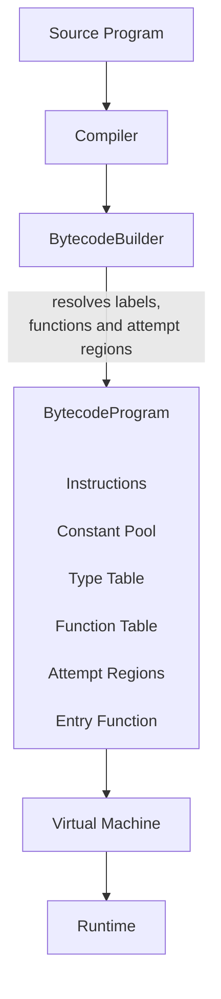

The bytecode module intentionally contains no execution logic. It defines the immutable program representation consumed by the virtual machine.

The VM is responsible for interpreting instructions, resolving constants and types into runtime objects, managing execution state, invoking functions, and implementing the runtime semantics of attempt regions.

---

## Architecture

The bytecode module is organized around the fundamental concepts that compose a compiled Morphe program.

```text
dev.morphe.bytecode
│
├── builder
│   ├── BytecodeBuilder
│   ├── Label
│   ├── FunctionRegistry
│   └── AttemptRegionRegistry
│
├── constants
│   ├── IConstant
│   ├── IntegerConstant
│   ├── DoubleConstant
│   ├── BooleanConstant
│   └── StringConstant
│
├── instructions
│   ├── Instruction
│   └── opcodes
│       ├── IOpCode
│       ├── ArithmeticOpCode
│       ├── ArrayOpCode
│       ├── CallOpCode
│       ├── ComparisonOpCode
│       ├── CompositeOpCode
│       ├── ControlOpCode
│       ├── IOOpCode
│       ├── LogicalOpCode
│       ├── ScopeOpCode
│       └── StackOpCode
│
├── program
│   ├── BytecodeProgram
│   ├── FunctionDefinition
│   ├── CaptureDefinition
│   ├── AttemptRegion
│   ├── ErrorHandler
│   └── BytecodeErrorKind
│
└── type
    ├── IBytecodeType
    ├── ArrayBytecodeType
    ├── BytecodeTypeKind
    ├── CompositeBytecodeType
    ├── FunctionBytecodeType
    ├── PrimitiveBytecodeType
    └── VoidBytecodeType
```

Each package has a single well-defined responsibility:

| Package | Responsibility |
|----------|----------------|
| `builder` | Constructs bytecode programs and resolves temporary construction state such as labels, functions, and attempt regions. |
| `constants` | Immutable literal values referenced by bytecode instructions. |
| `instructions` | Immutable instruction representation and opcode definitions. |
| `program` | Immutable structures describing the contents and metadata of a compiled bytecode program. |
| `type` | Bytecode-level type descriptions used by instructions and function signatures. |

The `builder` package is fundamentally different from the other packages.

The builder contains mutable construction state because a bytecode program must be assembled incrementally. Once `build()` succeeds, this temporary state is converted into the immutable `BytecodeProgram` representation.

The registries used by the builder are internal implementation details. They separate the stateful lifecycles of function definitions and attempt regions from the main orchestration performed by `BytecodeBuilder`.

The resulting `BytecodeProgram` does not depend on the builder or its registries.

The bytecode module remains independent from the runtime implementation.

None of the bytecode packages depend on runtime values, memory management, execution contexts, or the virtual machine itself. They describe only the structure and metadata of a compiled Morphe program.

---

## Constants

The `constants` package defines the immutable literal values stored in a bytecode program's constant pool.

Every constant implements the `IConstant` interface:

```java
public sealed interface IConstant permits
    IntegerConstant,
    DoubleConstant,
    BooleanConstant,
    StringConstant {
}
```

The currently supported constant types are:

* `IntegerConstant`
* `DoubleConstant`
* `BooleanConstant`
* `StringConstant`

Each constant is immutable and uses value-based equality.

For example:

```java
IConstant first = new IntegerConstant(42);
IConstant second = new IntegerConstant(42);
first.equals(second); // true
```

Constants are not embedded directly inside instructions. Instead, instructions reference entries in the program's constant pool using integer operands.

For example:

```text
PUSH 0
```

references the constant stored at index `0`:

```text
Constant Pool
─────────────
0 → IntegerConstant(42)
```

When executing the instruction, the virtual machine resolves the operand into the corresponding constant value and creates or obtains the appropriate runtime representation.

Using a constant pool keeps instructions compact and allows multiple instructions to share the same immutable constant.

---

## Types

The `type` package defines the type system used by the Morphe bytecode layer.

Bytecode types describe the structure of values known by compiled bytecode without depending on the runtime type system.

Every bytecode type implements the common interface:

```java
public interface IBytecodeType {
    BytecodeTypeKind kind();
}
```

The currently supported bytecode type categories are:

* `PrimitiveBytecodeType`
* `ArrayBytecodeType`
* `CompositeBytecodeType`
* `FunctionBytecodeType`
* `VoidBytecodeType`

Unlike runtime types, bytecode types are immutable descriptors that exist as metadata inside a `BytecodeProgram`.

### Primitive Types

`PrimitiveBytecodeType` represents the primitive value categories supported by the bytecode layer.

The currently available primitive types are:

* `INTEGER`
* `DOUBLE`
* `BOOLEAN`
* `STRING`

For example:

```java
PrimitiveBytecodeType.INTEGER
PrimitiveBytecodeType.DOUBLE
PrimitiveBytecodeType.BOOLEAN
PrimitiveBytecodeType.STRING
```

Each primitive exposes its corresponding `BytecodeTypeKind`.

```java
PrimitiveBytecodeType.INTEGER.kind();
```

returns:

```text
INTEGER
```

Primitive bytecode types describe only the type information encoded in bytecode.

They are not runtime values and do not define how primitive values are represented during execution.

---

### Array Types

`ArrayBytecodeType` represents an array whose elements are another bytecode type.

An array type is created from its element type:

```java
ArrayBytecodeType integers =
    new ArrayBytecodeType(
        PrimitiveBytecodeType.INTEGER
    );
```

Nested array types naturally describe multidimensional arrays.

For example:

```java
ArrayBytecodeType matrix =
    new ArrayBytecodeType(
        new ArrayBytecodeType(
            PrimitiveBytecodeType.INTEGER
        )
    );
```

represents:

```text
INTEGER[][]
```

Since the element type is itself an `IBytecodeType`, arrays may contain any bytecode type, including other arrays and composite types.

Array bytecode types are immutable and use structural equality.

For example:

```java
new ArrayBytecodeType(
    PrimitiveBytecodeType.INTEGER
).equals(
    new ArrayBytecodeType(
        PrimitiveBytecodeType.INTEGER
    )
);
```

returns:

```text
true
```

---

### Composite Types

`CompositeBytecodeType` represents the structure of a composite value encoded in bytecode.

A composite type describes a named collection of fields, where each field is associated with a bytecode type.

Composite types allow the bytecode layer to describe structured values without depending on their runtime representation.

Conceptually:

```text
Person
├── name   → STRING
└── age    → INTEGER
```

The bytecode type therefore describes the structure required by compiled instructions while leaving the actual runtime representation to the runtime and virtual machine layers.

Composite bytecode types are immutable descriptors and are compared structurally according to their declared metadata.

---

### Function Types

`FunctionBytecodeType` represents the signature of a function encoded in bytecode.

A function type consists of:

* an ordered list of parameter types;
* a declared return type.

For example:

```java
FunctionBytecodeType type =
    new FunctionBytecodeType(
        List.of(
            PrimitiveBytecodeType.INTEGER,
            PrimitiveBytecodeType.INTEGER
        ),
        PrimitiveBytecodeType.INTEGER
    );
```

represents:

```text
(Integer, Integer) -> Integer
```

Parameter types are immutable and preserve their declaration order.

The return type may be any bytecode type, including `VoidBytecodeType`.

Function bytecode types describe only the signature of a function.

They do not contain executable code, captured values, or runtime invocation state.

Those responsibilities belong to `FunctionDefinition` and, ultimately, to the virtual machine.

---

### Void Type

Some functions do not produce a return value.

For these cases the bytecode layer provides `VoidBytecodeType`.

Unlike primitive types, the void type does not represent a runtime value.

It exists solely to complete function signatures.

Since every void type is identical, the implementation exposes a single shared instance:

```java
VoidBytecodeType.INSTANCE
```

For example:

```java
FunctionBytecodeType print =
    new FunctionBytecodeType(
        List.of(
            PrimitiveBytecodeType.STRING
        ),
        VoidBytecodeType.INSTANCE
    );
```

represents:

```text
(String) -> void
```

Using a singleton avoids creating multiple identical instances while clearly expressing that all bytecode-level `void` types are equivalent.

---

## Instructions

The `instructions` package defines the executable units that compose a Morphe bytecode program.

Each instruction represents a single operation performed by the virtual machine.

Rather than storing executable behavior directly, instructions describe **what** operation must be executed together with the metadata required to perform it.

An instruction always consists of:

* an opcode;
* zero or more immediate operands.

For example:

```java
Instruction<StackOpCode> push = new Instruction<>(StackOpCode.PUSH, 0);
```

represents the conceptual bytecode instruction:

```text
PUSH 0
```

The meaning of the operands depends entirely on the opcode being executed.

---

### Instruction Structure

Every instruction is represented by the generic class:

```java
Instruction<T extends IOpCode>
```

Internally an instruction stores:

* its opcode;
* an immutable sequence of integer operands.

For example:

```java
Instruction<ArithmeticOpCode> add = new Instruction<>(ArithmeticOpCode.ADD);
Instruction<StackOpCode> push = new Instruction<>(StackOpCode.PUSH, 0);
```

Although operands are represented as integers, their interpretation depends on the opcode.

An operand may represent:

* a constant pool index;
* a type table index;
* a function-table index;
* an instruction position;
* a variable or scope reference;
* a field-name reference;
* a dimensionality or other structural parameter;
* any other opcode-specific metadata.

The instruction itself does not interpret operands.

Their meaning is defined by the opcode family and the VM execution semantics.

---

### Typed Instructions

Instructions preserve the type of the opcode family that created them.

Instead of storing only an `IOpCode`, they are parameterized by the opcode type:

```java
Instruction<T extends IOpCode>
```

This allows compile-time preservation of opcode categories.

For example:

```java
Instruction<StackOpCode> push = new Instruction<>(StackOpCode.PUSH, 0);
Instruction<ArithmeticOpCode> add = new Instruction<>(ArithmeticOpCode.ADD);
Instruction<CallOpCode> call = new Instruction<>(CallOpCode.CALL, 2);
```

Each instruction therefore retains its concrete opcode family instead of being treated as an untyped opcode.

A complete program, however, naturally contains instructions belonging to many different opcode families.

For this reason `BytecodeProgram` stores instructions as:

```java
List<Instruction<? extends IOpCode>>
```

allowing heterogeneous instruction sequences while preserving the type of every individual instruction.

---

### Operand Validation

Every opcode declares how many immediate operands it requires through:

```java
int operandCount();
```

For example:

```java
StackOpCode.PUSH.operandCount();   // 1
StackOpCode.POP.operandCount();    // 0
CallOpCode.CALL.operandCount();    // 1
CallOpCode.RETURN.operandCount();  // 0
```

`Instruction` validates this contract during construction.

An instruction whose operand count does not match the opcode cannot be created.

For example:

```java
new Instruction<>(StackOpCode.POP, 10);
```

is invalid because `POP` expects no immediate operands.

Likewise:

```java
new Instruction<>(StackOpCode.PUSH);
```

is invalid because `PUSH` requires one immediate operand.

This validation guarantees that every instruction stored inside a `BytecodeProgram` is structurally valid.

It is important to distinguish immediate operands from stack operands.

Immediate operands are encoded directly inside the instruction.

Values consumed from the operand stack are part of VM execution semantics and are not counted by `operandCount()`.

For example:

```java
ArithmeticOpCode.ADD.operandCount(); // 0
```

Although `ADD` consumes two values from the execution stack, it requires no immediate operands.

---

### Immutability

Instructions are immutable.

Both the opcode and operand array are fixed when the instruction is created.

The operand array is defensively copied during construction and whenever it is exposed:

```java
Instruction<StackOpCode> instruction = new Instruction<>(StackOpCode.LOAD, 10);
int[] operands = instruction.operands();
operands[0] = 99;
```

The original instruction remains unchanged.

When a modified instruction is required, a new instance can be created using `withOperand(...)`:

```java
Instruction<StackOpCode> original = new Instruction<>(StackOpCode.LOAD, 10);
Instruction<StackOpCode> modified = original.withOperand(0, 99);
```

The resulting instructions are independent:

```text
Original:  LOAD [10]
Modified:  LOAD [99]
```

This functional approach avoids accidental mutation and guarantees that instructions stored inside a `BytecodeProgram` remain stable throughout their lifetime.

---

## Opcode Families

Bytecode instructions are organized into opcode families according to the kind of operation they perform.

Each family groups instructions that share a common responsibility, such as manipulating the operand stack, performing arithmetic operations, controlling program execution, or interacting with runtime services.

All opcode families implement the common `IOpCode` interface, allowing every instruction to expose the number of immediate operands it requires through `operandCount()`.

The current Morphe bytecode instruction set is divided into the following opcode families:

* Stack
* Scope
* Arithmetic
* Comparison
* Logical
* Arrays
* Composite
* Call
* Control Flow
* Input / Output

Each family is described in the following sections.

---

### Stack

`StackOpCode` defines the bytecode instructions responsible for manipulating the virtual machine operand stack.

The operand stack is the primary mechanism used to exchange values between bytecode instructions.

The currently supported stack operations are:

* `PUSH` — pushes a constant referenced by the constant pool onto the operand stack.
* `POP` — removes the value currently on top of the operand stack.
* `OVER` — duplicates the value immediately below the top of the operand stack.
* `DUP` — duplicates the value currently on top of the operand stack.

Some stack instructions require immediate operands encoded directly in the instruction, while others operate exclusively on the current stack state.

For example:

```text
PUSH 0
```

pushes onto the operand stack the constant referenced by constant pool entry `0`.

---

### Scope

`ScopeOpCode` defines the bytecode instructions responsible for variable access and runtime scope management.

Scopes provide the mechanism used by the virtual machine to organize variable visibility and lifetime during program execution.

The currently supported scope operations are:

* `STORE` — stores a value into a variable location.
* `LOAD` — loads a value from a variable location onto the operand stack.
* `ENTER_SCOPE` — creates a new nested runtime scope.
* `EXIT_SCOPE` — leaves the current scope.

Variable access instructions use immediate metadata identifying the storage location referenced by the instruction.

For example:

```text
LOAD 5
```

references the variable location represented by `5`.

Scope management instructions operate directly on runtime scope state and therefore do not require immediate operands.

Conceptually, scopes form a parent-child hierarchy:

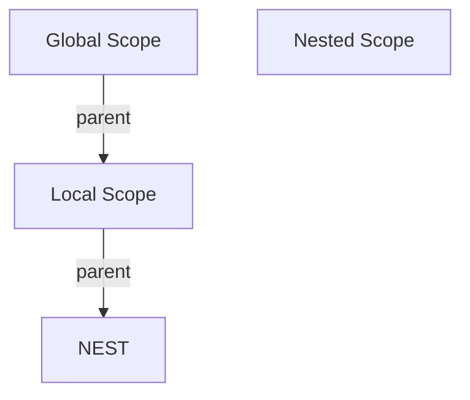

The exact rules governing variable creation, lookup, shadowing, captures, and scope lifetime are defined by the virtual machine.

---

### Arithmetic

`ArithmeticOpCode` defines the bytecode instructions responsible for performing numeric arithmetic operations.

Arithmetic instructions consume their operands from the virtual machine operand stack and push the resulting value back onto the stack.

The currently supported arithmetic operations are:

* `ADD` — adds two numeric values.
* `SUB` — subtracts one numeric value from another.
* `MUL` — multiplies two numeric values.
* `DIV` — divides one numeric value by another.
* `MOD` — computes the remainder of a division.

Arithmetic instructions do not require immediate operands because both input values are obtained directly from the operand stack.

Conceptually:

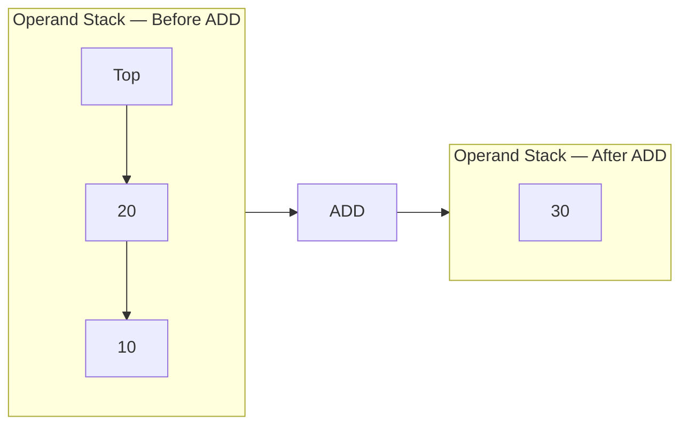

The exact numeric semantics, including type promotion, overflow behavior, and errors such as division by zero, are defined by the virtual machine.

---

### Comparison

`ComparisonOpCode` defines the bytecode instructions responsible for comparing two values.

Comparison instructions consume their operands from the virtual machine operand stack and push a boolean result.

The currently supported comparison operations are:

* `EQ` — tests whether two values are equal.
* `NEQ` — tests whether two values are different.
* `GT` — tests whether the left value is greater than the right value.
* `GTE` — tests whether the left value is greater than or equal to the right value.
* `LT` — tests whether the left value is less than the right value.
* `LTE` — tests whether the left value is less than or equal to the right value.

Comparison instructions do not require immediate operands because both values are obtained directly from the operand stack.

The exact comparison rules and supported operand types are defined by the virtual machine.

---

### Logical

`LogicalOpCode` defines the bytecode instructions responsible for evaluating boolean logic.

The currently supported logical operations are:

* `AND` — logical conjunction.
* `OR` — logical disjunction.
* `NOT` — logical negation.

Binary operations consume two boolean values while unary operations consume one.

For example:

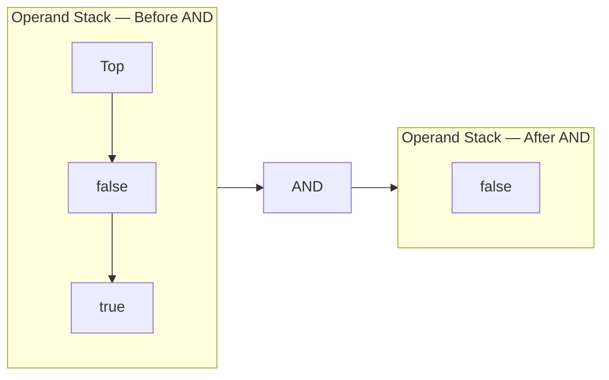

The exact boolean semantics are defined by the virtual machine.

---

### Arrays

`ArrayOpCode` defines the bytecode instructions responsible for creating and manipulating arrays.

Array instructions operate on array references stored on the virtual machine operand stack. Depending on the operation, they may also consume element indices, values, or array sizes from the stack.

The currently supported array operations are:

* `ARRAY_NEW` — creates a one-dimensional array.
* `ARRAY_NEW_MULTI` — creates a multidimensional array.
* `ARRAY_GET` — reads an element from an array.
* `ARRAY_SET` — writes an element into an array.
* `ARRAY_LENGTH` — obtains the length of an array.

Array creation instructions reference the program type table through immediate operands.

For example:

```text
ARRAY_NEW <type-index>
```

where the operand identifies the array type stored in the type table.

Conceptually:

```text
Type Table

0 → INTEGER[]
1 → STRING[]
2 → INTEGER[][]

Instruction

ARRAY_NEW 0
      │
      ▼
Type Table[0] → INTEGER[]
```

`ARRAY_NEW_MULTI` extends this mechanism with metadata describing the array type and dimensionality. The size of each dimension is obtained from the operand stack.

Array access operations obtain their required values directly from the operand stack.

The exact runtime representation of arrays, bounds checking, multidimensional allocation strategy, and element storage semantics are defined by the virtual machine.

---

### Composite

`CompositeOpCode` defines the bytecode instructions responsible for creating and manipulating fields of composite values.

Composite values are structured values whose fields are described by `CompositeBytecodeType`.

The currently supported composite operations are:

* `COMPOSITE_NEW` — creates a composite value of a specified bytecode type.
* `GET_FIELD` — retrieves the value stored in a specified field.
* `SET_FIELD` — assigns a value to a specified field.

#### Creating Composite Values

`COMPOSITE_NEW` requires one immediate operand:

```text
COMPOSITE_NEW <type-index>
```

The operand identifies the CompositeBytecodeType stored in the program's type table.

The values required by the composite are consumed from the operand stack according to the field order defined by the composite type.

For example, given:

```text
Person {
    name : STRING
    age  : INTEGER
}
```

the compiler can emit:

```text
PUSH <name>
PUSH <age>
COMPOSITE_NEW <person-type-index>
```

The resulting composite value is pushed onto the operand stack.

Conceptually:

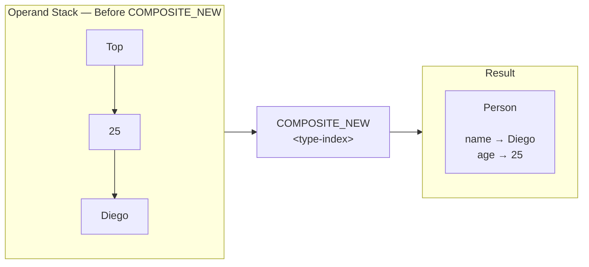

The order in which values are consumed is determined by the field order declared by the composite bytecode type.

---

### Field Access

`GET_FIELD` retrieves a field from a composite value.

It requires one immediate operand:

```text
GET_FIELD <field-name-constant-index>
```

The operand identifies a constant-pool entry containing the field name.

The composite value is obtained from the operand stack and the requested field value is pushed back onto the stack.

For example:

```text
GET_FIELD 0
```

where constant-pool entry `0` contains:

```text
StringConstant("name")
```
conceptually performs:

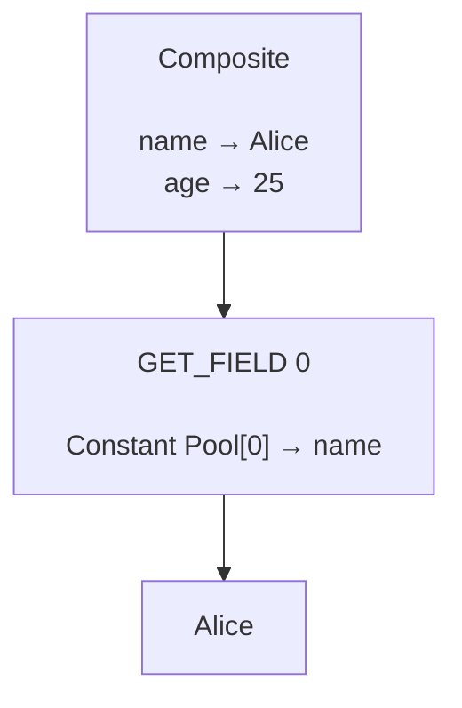

The bytecode instruction does not contain the field name directly. It references the corresponding constant-pool entry.

Field Assignment

`SET_FIELD` assigns a value to a field of a composite value.

It also requires one immediate operand:

```text
SET_FIELD <field-name-constant-index>
```

The operand identifies a constant-pool entry containing the field name.

The value to assign and the composite target are consumed from the operand stack.

Conceptually:

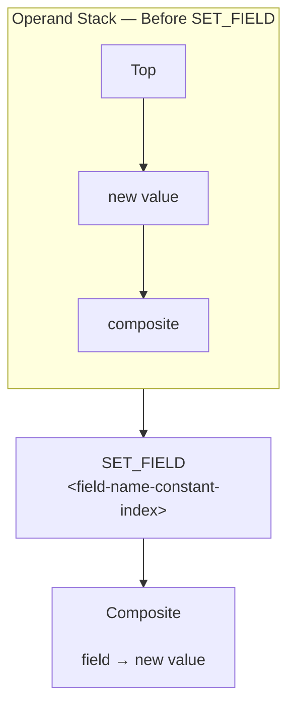

The exact stack ordering is part of the VM execution semantics and must remain consistent between the compiler and virtual machine.

Both `GET_FIELD` and `SET_FIELD` use field names stored in the constant pool rather than embedding field identifiers directly into the instruction.

This allows field names to be represented using the same immutable constant-pool mechanism used by other bytecode metadata.

The bytecode layer defines only the structural representation of composite operations. Composite value creation, field lookup, field validation, mutability, and runtime storage are implemented by the runtime and virtual machine layers.

---

### Call

`CallOpCode` defines the bytecode instructions responsible for function invocation and function return.

The currently supported call operations are:

* `CALL` — invokes a function.
* `RETURN` — returns from the current function.

`CALL` requires one immediate operand:

```text
CALL <function-index>
```

The operand identifies the function definition stored in the program's function table.

Conceptually:

```text
Function Table

0 → main
1 → sum
2 → print

Instruction

CALL 1
```

When executed, the virtual machine resolves the referenced function, creates a call frame, stores the return address, transfers control to the function's entry point, and begins executing its instructions.

Functions may also contain capture definitions describing values obtained from enclosing scopes.

Those capture definitions are part of the function metadata and are not runtime values stored directly inside the bytecode program.

`RETURN` terminates execution of the current function, restores the previous call frame, and resumes execution at the caller.

Functions that produce a return value leave that value on the operand stack before executing `RETURN`.

The exact representation of call frames, argument passing, recursion, captures, local storage, and return-value handling are defined by the virtual machine.

---

### Control Flow

`ControlOpCode` defines the bytecode instructions responsible for controlling program execution flow.

Control-flow instructions modify the instruction pointer maintained by the virtual machine.

The currently supported operations are:

* `HALT` — terminates program execution.
* `JMP` — performs an unconditional jump.
* `JMP_IF_TRUE` — performs a conditional jump when the evaluated condition is true.
* `JMP_IF_FALSE` — performs a conditional jump when the evaluated condition is false.

Jump instructions use an immediate operand representing the destination instruction index.

For example:

```text
JMP <instruction-index>
```

Conceptually:

```text
Instruction List

0  PUSH ...
1  PUSH ...
2  JMP 6
3  ...
4  ...
5  ...
6  HALT
```

When the virtual machine executes `JMP 6`, execution continues at instruction `6`.

Conditional jumps additionally consume a boolean value from the operand stack.

For example:

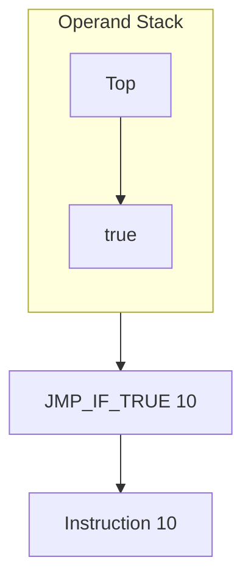

If the condition is true, execution continues at instruction `10`. Otherwise, execution proceeds with the next sequential instruction.

This mechanism allows higher-level constructs such as `if`, `else`, `while`, `for`, and other branching structures to be represented through bytecode instructions.

`HALT` terminates execution immediately.

The bytecode layer only defines the structural representation of control-flow operations. Instruction pointer management and execution semantics are implemented by the virtual machine.

---

### Input / Output

`IOOpCode` defines the bytecode instructions responsible for interacting with the execution environment.

The currently supported operations are:

* `INPUT` — obtains a value from the configured input provider.
* `PRINT` — sends a value to the configured output provider.

`INPUT` obtains its result from the VM's configured input service and makes the resulting runtime value available to the execution stack.

`PRINT` consumes the value required by the output operation and delegates its presentation to the configured output service.

Neither instruction specifies how input is obtained or how output is displayed.

Those responsibilities belong to the virtual machine and its host environment.

This separation allows the same bytecode program to execute in different environments without modification.

Possible hosts include:

* Console applications.
* Desktop applications.
* Web applications.
* Automated test environments.
* IDE integrations.
* Embedded hosts.
* Remote execution environments.

The bytecode only represents the intent to perform an I/O operation. The concrete behavior is determined by the virtual machine.

---

## Functions

Functions are represented in bytecode by `FunctionDefinition`.

A function definition contains the immutable metadata required by the virtual machine to identify and invoke a function.

A function definition consists of:

* a name;
* a `FunctionBytecodeType` signature;
* an instruction entry point;
* capture definitions.

Conceptually:

```text
FunctionDefinition
│
├── Name
├── Function Type
│   ├── Parameter Types
│   └── Return Type
├── Entry Point
└── Captures
```

For example:

```text
sum(Integer, Integer) -> Integer
entry point: 24
captures: []
```

The entry point identifies the first instruction executed when the function is invoked.

The function table stores these definitions by index.

For example:

```text
Function Table
────────────────────────────────────────
0 → main()        -> void  @0
1 → sum(int,int)  -> int   @24
2 → print(string) -> void  @58
```

Function invocation instructions reference these definitions through their function-table index.

---

### Function Captures

`CaptureDefinition` describes a value that a function obtains from an enclosing scope.

Captures are metadata associated with a function definition rather than runtime values embedded directly into the bytecode program.

Conceptually:

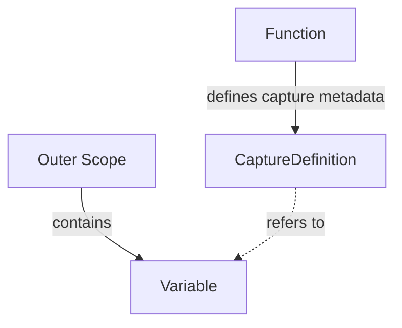

This allows functions to retain references to values defined outside their immediate scope.

The bytecode layer only describes which values must be captured. The virtual machine is responsible for resolving and storing the corresponding runtime values when the function is executed or instantiated.

---

## Attempt Regions

`AttemptRegion` represents a protected range of bytecode instructions associated with error handling.

It provides the bytecode-level representation of Morphe's `attempt` construct.

An attempt region contains:

* a start instruction position;
* an end instruction position;
* a fallback instruction position;
* zero or more error handlers.

Conceptually:

```text
AttemptRegion
│
├── Start
├── End
├── Fallback
└── Error Handlers
```

For example:

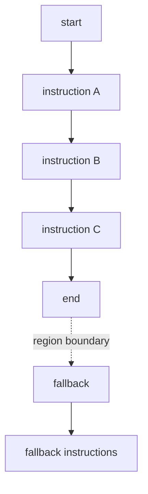

The protected region identifies the instructions whose execution may produce an error handled by the region.

The fallback identifies the instruction position to which execution can be redirected when the attempt fails.

---

### Error Handlers

An `ErrorHandler` associates a specific `BytecodeErrorKind` with an instruction entry point.

Currently supported bytecode error kinds include:

* `DIVISION_BY_ZERO`
* `MODULO_BY_ZERO`
* `INVALID_ARRAY_INDEX`

Conceptually:

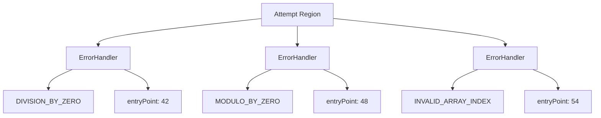

The bytecode layer does not execute these handlers.

It only records the relationship between an error category and the instruction position that handles it.

The virtual machine is responsible for detecting runtime errors, locating the corresponding attempt region, selecting the appropriate handler, and transferring execution.

---

### Attempt Region Construction

Attempt regions are commonly constructed before all instruction positions are known.

For this reason the builder uses labels during construction.

Conceptually:

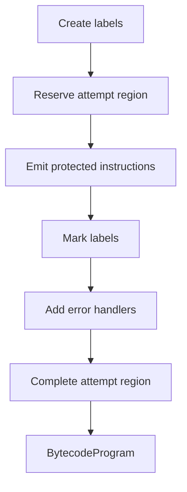

Labels are resolved into concrete instruction positions when the region is completed.

This allows the compiler to construct forward references without requiring instruction positions to be known in advance.

---

## Bytecode Builder

`BytecodeBuilder` is the construction API used to assemble a `BytecodeProgram`.

Unlike the resulting bytecode program, the builder is mutable because compilation proceeds incrementally.

The builder manages:

* emitted instructions;
* constants;
* bytecode types;
* labels;
* function definitions;
* attempt regions;
* the entry function.

Conceptually:

```text
Compiler
   │
   ▼
BytecodeBuilder
   │
   ├── Instructions
   ├── Constants
   ├── Types
   ├── Labels
   ├── Functions
   └── Attempt Regions
   │
   ▼
build()
   │
   ▼
BytecodeProgram
```

The builder performs the necessary resolution and validation before producing the final immutable program.

---

### Labels

`Label` represents a symbolic instruction position during bytecode construction.

A label can be created before its final instruction position is known.

For example:

```java
Label target = builder.createLabel();
builder.emit(ControlOpCode.JMP, target);
builder.emit(...);
builder.mark(target);
```

The jump can therefore reference a future instruction without requiring the compiler to know its numerical position immediately.

When the program is built, the builder resolves the label into its concrete instruction index.

Conceptually:

```text
Before resolution:
JMP target
target → Label
```

After resolution:

```text
JMP 12
```

Labels belong to the construction process and are not part of the final `BytecodeProgram`.

---

### Constant Registration

The builder maintains the program's constant pool.

When a constant is registered, the builder returns its index:

```java
int index = builder.constant(new IntegerConstant(42));
```

Equal constants reuse the same pool entry.

Conceptually:

```text
constant(42) → 0
constant(42) → 0
constant(10) → 1
```

This allows instructions to reference shared constant-pool entries without duplicating equal constants.

---

### Type Registration

The builder maintains the program's type table.

When a type is registered, the builder returns its index:

```java
int index = builder.type(PrimitiveBytecodeType.INTEGER);
```

Equal types reuse the same type-table entry.

This allows complex bytecode types to be shared by multiple instructions or function definitions.

---

### Function Registration

The builder supports two function construction paths.

A fully resolved function can be registered directly:

```java
int index = builder.function(functionDefinition);
```

Alternatively, a function can be reserved before its entry point is known:

```java
int index = builder.function("main", functionType, entryPoint);
```

The reserved function retains its assigned function-table index while its final definition is completed later.

This is useful when function metadata must be known before the compiler has emitted the function body.

Once the entry point has been marked, the function can be completed:

```java
builder.completeFunction(index, captures);
```

The builder rejects construction of the final program while unresolved functions remain.

---

### Attempt Region Registration

Attempt regions use a similar reserve-and-complete lifecycle.

A region can be reserved using symbolic labels:

```java
int region = builder.reserveAttempt(start, end, fallback);
```

Error handlers can then be associated with the region:

```java
builder.addErrorHandler(region, BytecodeErrorKind.DIVISION_BY_ZERO, handler);
```

Once all required labels have been marked, the region can be completed:

```java
builder.completeAttemptRegion(region);
```

The builder resolves the labels into concrete instruction positions and creates the immutable `AttemptRegion`.

Unresolved attempt regions prevent the final program from being built.

---

### Building the Program

The final program is created with:

```java
BytecodeProgram program = builder.build();
```

Before producing the program, the builder validates the construction state.

In particular:

* all referenced labels must be resolved;
* all reserved functions must be completed;
* all reserved attempt regions must be completed;
* an entry function must be defined.

Only after these conditions are satisfied does the builder create the immutable `BytecodeProgram`.

The resulting program no longer depends on the builder's mutable construction state.

---

## Bytecode Program

`BytecodeProgram` is the immutable top-level representation of a compiled Morphe program.

A bytecode program groups together the executable instruction sequence and the indexed metadata referenced by those instructions.

Conceptually:

```text
BytecodeProgram
│
├── Instructions
├── Constant Pool
├── Type Table
├── Function Table
├── Attempt Regions
└── Entry Function
```

The instruction sequence contains the executable operations of the program, while the remaining tables and metadata provide the information required during execution.

The program is immutable after construction.

---

### Constant Pool

The constant pool stores every literal value referenced by the program.

Rather than embedding literal values directly into instructions, constants are stored once inside the program and referenced by their index.

For example:

```text
PUSH 0
```

references:

```text
Constant Pool
─────────────
0 → IntegerConstant(42)
1 → StringConstant("Hello")
2 → BooleanConstant(true)
```

During execution, the virtual machine resolves the referenced constant into the corresponding runtime representation.

---

### Type Table

The type table stores every bytecode-level type referenced by the program.

For example:

```text
Type Table
────────────────────────────────────────
0 → INTEGER
1 → INTEGER[]
2 → (INTEGER, INTEGER) -> INTEGER
3 → Person
```

Instructions can reference these entries through integer operands.

Keeping type information separate from instructions reduces redundancy and allows complex types to be shared throughout the program.

---

### Function Table

The function table contains every function defined by the program.

Each entry is represented by a `FunctionDefinition`.

A definition contains:

* the function name;
* its function signature;
* its instruction entry point;
* its capture definitions.

Conceptually:

```text
Function Table
────────────────────────────────────────────
0 → main()        -> void  @0
1 → sum(int,int)  -> int   @24
2 → print(string) -> void  @58
```

Function invocation instructions reference these entries by index.

For example:

```text
CALL 1
```

identifies the function stored at function-table position `1`.

---

### Attempt Regions

The attempt-region table contains the error-handling metadata associated with the program.

Each entry identifies a protected instruction range, its fallback entry point, and its associated error handlers.

Conceptually:

```text
Attempt Regions
────────────────────────────────────────────
0 → [10, 24)
      fallback → 30
      DIVISION_BY_ZERO → 40
      MODULO_BY_ZERO   → 45
```

The exact execution behavior is implemented by the virtual machine.

The bytecode program only stores the immutable structural metadata required to perform that behavior.

---

### Entry Function

Every `BytecodeProgram` has an entry function.

The entry function identifies the function from which normal program execution begins.

It is stored as a function-table index rather than as a direct `FunctionDefinition` reference.

For example:

```text
Entry Function
───────────────
0
```

combined with:

```text
Function Table
──────────────
0 → main() -> void @0
1 → helper() -> void @20
```

means that execution begins with function `main`.

The entry function is validated when the `BytecodeProgram` is constructed.

---

## Example

The following example illustrates how the main bytecode components fit together into a complete program.

Consider a Morphe program conceptually equivalent to:

```text
Integer add(Integer a, Integer b) {
    return a + b
}

Integer result = add(10, 20)
print(result)
```

At the bytecode level, the program may contain the following components.

### Constant Pool

```text
Index   Constant
────────────────────────
0       IntegerConstant(10)
1       IntegerConstant(20)
```

### Type Table

```text
Index   Type
──────────────────────────────────────────────
0       INTEGER
1       (INTEGER, INTEGER) -> INTEGER
```

### Function Table

```text
Index   Function
──────────────────────────────────────────────
0       add(Integer, Integer) -> Integer @0
1       main() -> void @4
```

### Attempt Regions

If the program contains no `attempt` blocks:

```text
Attempt Regions
────────────────
(empty)
```

### Instructions

Conceptually:

```text
Index   Instruction
──────────────────────────────
0       LOAD ...
1       LOAD ...
2       ADD
3       RETURN

4       PUSH 0
5       PUSH 1
6       CALL 0
7       PRINT
8       HALT
```

The exact operands used for variable access depend on the scope and memory model implemented by the VM.

The important aspect is how the components reference one another:

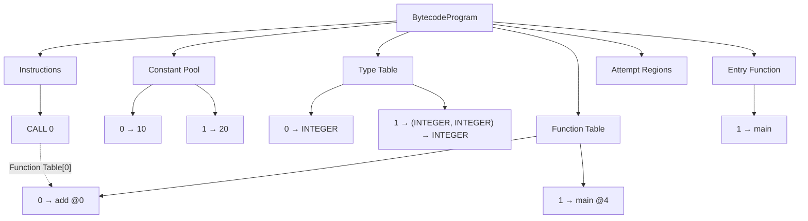

A `PUSH 0` instruction therefore does not contain the literal value `10`. It references constant-pool entry `0`.

Likewise, `CALL 0` identifies the function stored at function-table position `0`.

The bytecode representation consequently separates executable instructions from the data and metadata they reference.

---

## Design Principles

The bytecode layer follows a small set of principles that define its responsibilities and boundaries.

### Separation of Concerns

The bytecode module represents compiled program structure.

It does not implement runtime execution.

Bytecode types, constants, instructions, functions, and attempt regions describe what a program contains, while the VM determines how that program executes.

### Immutability

The final bytecode representation is immutable.

This includes:

* Constants.
* Bytecode types.
* Instructions.
* Function definitions.
* Capture definitions.
* Error handlers.
* Attempt regions.
* Constant pools.
* Type tables.
* Function tables.
* Bytecode programs.

The `BytecodeBuilder` is intentionally mutable because it represents an intermediate construction phase.

Once `build()` succeeds, mutable construction state is converted into immutable bytecode structures.

### Indexed References

Instructions use integer operands to reference indexed program data or encoded metadata.

Depending on the opcode, operands may represent:

* Constant pool indices.
* Type table indices.
* Function identifiers.
* Instruction positions.
* Variable or scope references.
* Field identifiers.
* Structural metadata.

The meaning of an operand is defined by the opcode that owns it.

### Symbolic Construction

The builder uses labels to represent instruction positions before those positions are known.

This allows forward references and incremental bytecode generation without requiring the compiler to calculate instruction offsets manually.

Labels are construction-time objects and are resolved before the final program is created.

### Explicit Opcode Contracts

Every opcode declares its immediate operand count through:

```java
int operandCount();
```

`Instruction` validates this contract when an instruction is created.

This prevents malformed instructions from entering the bytecode representation.

The immediate operand count describes only data encoded directly in the instruction. It does not describe values consumed from or produced onto the VM execution stack.

### Typed Instructions

Instructions preserve their relationship with their opcode family through generic typing:

```java
Instruction<T extends IOpCode>
```

This provides compile-time type information for individual instructions while still allowing `BytecodeProgram` to contain heterogeneous instruction sequences through:

```java
Instruction<? extends IOpCode>
```

The design therefore combines type safety at the instruction level with flexibility at the program level.

### Runtime Independence

Bytecode structures do not depend on concrete runtime value implementations.

For example:

```java
PrimitiveBytecodeType.INTEGER
```

describes an integer at the bytecode level without determining which runtime class represents that value.

Likewise, an `AttemptRegion` describes the structure of error handling without implementing the runtime error mechanism.

The VM is responsible for resolving bytecode-level information into runtime representations and behavior.

### Execution Independence

The bytecode layer does not maintain execution state.

Responsibilities such as:

* Instruction pointer management.
* Operand stack management.
* Scope resolution.
* Memory management.
* Call frames.
* Runtime captures.
* Execution contexts.
* Input/output services.
* Runtime error dispatch.

belong to the VM and runtime layers.

This keeps the bytecode module focused on representing compiled program structure rather than implementing execution semantics.

### Construction vs. Representation

The module deliberately separates construction-time state from final program representation.

`BytecodeBuilder` manages mutable state required while compiling a program.

`BytecodeProgram` contains only the resolved immutable result.

This distinction allows the compiler to construct forward references, reserve functions, and assemble attempt regions incrementally while ensuring that the VM receives a fully resolved program.

---

## Current Scope

The bytecode module currently provides the structural representation required to describe Morphe programs before execution.

It currently defines:

* Immutable constants.
* Primitive, array, composite, function, and void bytecode types.
* Typed immutable instructions.
* Explicit opcode contracts.
* Stack and scope operations.
* Arithmetic, comparison, and logical operations.
* Array operations.
* Composite-value operations.
* Function invocation and return operations.
* Function definitions.
* Function capture metadata.
* Control-flow operations.
* Input/output operations.
* Constant pools.
* Type tables.
* Function tables.
* Attempt regions.
* Error handlers and bytecode error kinds.
* Entry-function metadata.
* Symbolic instruction labels.
* A bytecode construction API through `BytecodeBuilder`.
* Immutable `BytecodeProgram` instances.

The bytecode layer intentionally remains independent from runtime values and VM execution state.

The next architectural boundary is the VM execution layer, which consumes `BytecodeProgram` instances and provides the runtime semantics for their instructions, functions, scopes, arrays, composite values, and error handling.

In short:

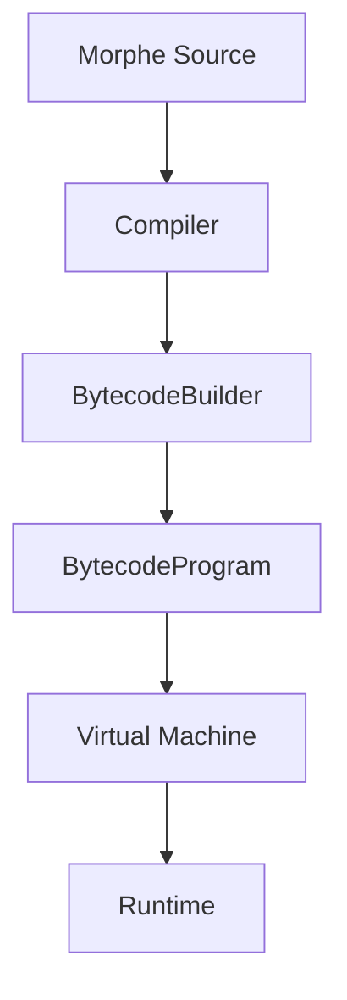

The bytecode module defines **the representation** between compilation and execution.

The builder defines **how that representation is constructed**.

The VM defines **how the representation is executed**.