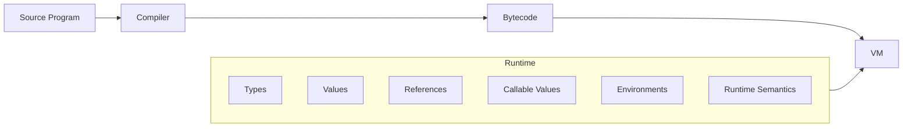
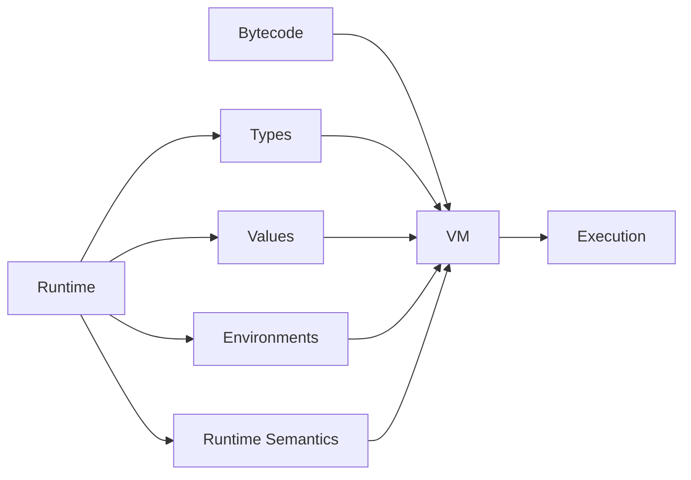
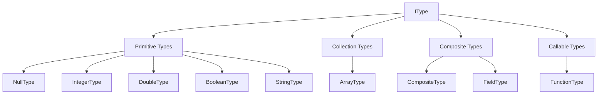

## Overview

The `runtime` module defines the semantic foundation of the Morphe
execution environment.

While the `bytecode` module describes the structure of a compiled Morphe
program, the runtime defines the types, values, and state abstractions
that give that program meaning during execution. It represents runtime
types, runtime values, references, callable values, variable storage,
closure environments, and the invariants that must hold while values are
manipulated by the virtual machine.

The runtime layer is intentionally independent from the execution
mechanism itself. It does not execute bytecode, maintain the operand
stack, manage instruction pointers, or control program flow. Instead, it
provides the runtime abstractions required by the VM to perform those
responsibilities.

The main components of this module are:

- **Types** --- runtime descriptions of the kinds of values that exist
during execution.

- **Values** --- runtime representations of Morphe data.

- **Primitive values** --- scalar values such as integers, doubles,
booleans, strings, and null.

- **Numeric values** --- a common abstraction for numeric runtime
values.

- **Collection values** --- runtime representations of structured
collections such as arrays.

- **Composite values** --- runtime representations of values composed
from named fields.

- **Reference values** --- runtime representations of references to
other runtime objects.

- **Callable values** --- runtime representations of functions as
first-class values.

- **Variable cells** --- mutable storage locations used to represent
variables and shared captured state.

- **Closure environments** --- collections of captured variable cells
associated with function values.

- **Type and value metadata** --- `TypeKind` and `ValueKind`, which
classify runtime entities.

- **Runtime semantics** --- validation, equality, type acceptance,
structural relationships, and other invariants required by runtime
values and types.

- **State snapshots** --- snapshots of mutable runtime state used by
the VM as part of transactional execution and `attempt` rollback.

The runtime layer therefore acts as the semantic boundary between
bytecode representation and execution:



The VM consumes these abstractions while executing a `BytecodeProgram`.
The runtime does not determine how execution is performed; it defines
the objects and rules that the VM operates on.

Although most runtime values are immutable, some runtime abstractions
intentionally represent mutable execution state. `CompositeValue` allows
its fields to be updated, while `VariableCell` provides mutable storage
that can be shared between scopes and closure environments.
`ClosureEnvironment` manages these captured cells and provides snapshot
and restoration operations that allow the VM to participate in
transactional state restoration.

These snapshots are not themselves a complete representation of VM
state. Rather, they represent the closure-environment portion of a
larger VM state snapshot. When an `attempt` fails, the VM can restore
the relevant runtime state, including captured variable values, before
transferring control to the appropriate fallback or error handler.

This separation allows the execution engine to evolve independently from
the representation of runtime values, types, and mutable runtime state.

---

## Architecture

The runtime is organized around two closely related concepts: **types**
and **values**.

A runtime type describes what kind of value a value represents, while a
runtime value contains the actual data associated with that type.

The central relationship can be represented as:

``` text
Runtime Type
     │
     │ describes
     ▼
Runtime Value
```

The runtime type system is represented through `IType` and its
associated type classifications. Runtime values are represented through
`IValue` and its value hierarchy.

Conceptually:

``` text
Runtime
│
├── Type System
│   ├── IType
│   ├── TypeKind
│   └── Concrete Runtime Types
│
├── Value System
│   ├── IValue
│   ├── ValueKind
│   ├── Primitive Values
│   ├── Numeric Values
│   ├── Array Values
│   ├── Composite Values
│   ├── Reference Values
│   └── Callable Values
│
├── Runtime State
│   ├── VariableCell
│   └── ClosureEnvironment
│
└── Runtime Semantics
    ├── Type Validation
    ├── Value Equality
    ├── Structural Relationships
    └── Runtime Invariants
```

The value hierarchy includes primitive, collection, composite,
reference, and callable values:

``` text
IValue
│
├── Primitive Values
│   ├── NullValue
│   ├── BooleanValue
│   ├── StringValue
│   ├── IntegerValue
│   └── DoubleValue
│
├── ArrayValue
├── CompositeValue
├── ReferenceValue
│
└── Callable Values
    └── FunctionValue
```

Numeric values share the `INumericValue` abstraction, allowing
operations that work with numeric values to operate independently of
their concrete representation.

The runtime also distinguishes between the kind of a type and the kind
of a value. `TypeKind` classifies runtime types, while `ValueKind`
classifies runtime values. This allows the runtime to reason about
semantic categories without coupling those categories to a particular
implementation class.

### Runtime State and Environments

In addition to describing values, the runtime provides abstractions for
mutable storage and captured execution state.

`VariableCell` represents a mutable storage location containing a
runtime value. Cells allow variables to be updated while preserving
their identity, which is important when the same variable is shared by
multiple scopes or closures.

`ClosureEnvironment` stores captured `VariableCell` instances by capture
index. Because environments retain the cells themselves rather than
copies of their values, updates remain visible to every part of the
runtime that references the same cell.

`ClosureEnvironment` also provides `Snapshot` and `restore` operations.
These operations are used by the VM as part of transactional state
restoration for `attempt` execution. A closure-environment snapshot
records the current values of its captured cells and can later restore
those values into the existing cells without replacing the cells
themselves.

The closure environment therefore represents one component of the
mutable state that the VM may include in a larger VM state snapshot:

``` text
VM State Snapshot
│
├── Execution State
├── Operand Stack
├── Call State
├── Runtime Environments
│   └── Closure Environments
│       └── Captured Variable Values
└── Other VM State
```

The runtime does not define the complete VM state or perform the
rollback itself. It only provides the state abstractions required by the
VM to perform those operations.

### Runtime and VM Boundary

The runtime does not execute bytecode.

The VM is responsible for execution state and execution semantics,
including:

-   Instruction dispatch.
-   The instruction pointer.
-   Operand-stack management.
-   Call frames.
-   Heap and memory management.
-   Allocation.
-   Reference resolution.
-   Control flow.

The runtime instead provides the semantic objects manipulated by those
mechanisms:



The VM owns execution state and coordinates the operations required to
execute a `BytecodeProgram`. The runtime provides the values, types,
references, callable values, and environment abstractions that the VM
resolves and manipulates during execution.

For example, when the VM executes an arithmetic instruction, the VM is
responsible for obtaining the operands from the execution stack and
coordinating the operation. The runtime provides the numeric values and
the value-level abstractions required to represent the result.

Likewise, the VM is responsible for resolving references against its
memory model, while the runtime provides `ReferenceValue` as the
value-level representation of a reference.

This separation is intentional:

``` text
Runtime → What values, types, and runtime state mean
VM      → How programs execute using them
```

The runtime therefore acts as the semantic foundation of the Morphe
execution environment without becoming coupled to the mechanics of
bytecode execution.

---

## Type System

The Morphe Runtime type system defines the semantic types used to
describe and validate runtime values.

Runtime types are represented by `IType`. A type describes which runtime
values are valid for that type and provides the type's name and
`TypeKind`. Types do not represent runtime data themselves; they
describe the structure and validity rules that runtime values must
satisfy.

The current Runtime type system is organized into four main categories:

``` text
IType
│
├── Primitive Types
│   ├── NullType
│   ├── IntegerType
│   ├── DoubleType
│   ├── BooleanType
│   └── StringType
│
├── Collection Types
│   └── ArrayType
│
├── Composite Types
│   ├── CompositeType
│   └── FieldType
│
└── Callable Types
    └── FunctionType
```

The type system is intentionally separated from the value system:

``` text
             IType
               │
               │ describes / accepts
               ▼
             IValue
```

For example:

``` text
IntegerType
    │
    └── accepts(IntegerValue)

ArrayType(IntegerType)
    │
    └── accepts(ArrayValue)

CompositeType
    │
    └── accepts(CompositeValue)

FunctionType
    │
    └── accepts(FunctionValue)
```

This distinction allows the Runtime to define type compatibility
independently from the concrete Java classes used to implement runtime
values.

------------------------------------------------------------------------

### TypeKind

`TypeKind` classifies runtime types according to their semantic
category.

It provides a lightweight classification mechanism that allows the
Runtime and VM to identify the general category of a type without
depending directly on its concrete implementation class.

Runtime types expose their classification through `IType`:

``` java
TypeKind kind();
```

The type kind is distinct from `ValueKind`.

``` text
TypeKind
    │
    └── classifies IType

ValueKind
    │
    └── classifies IValue
```

This distinction is important because a type definition and a runtime
value have different semantic responsibilities.

A type answers:

``` text
"What kind of value does this type accept?"
```

while a value answers:

``` text
"What kind of runtime value is this?"
```

The Runtime therefore maintains separate classifications for both sides
of the type/value relationship.

------------------------------------------------------------------------

### Primitive Types

Primitive types describe atomic runtime values that do not contain other
runtime values.

The current Runtime provides five primitive types:

-   `NullType`
-   `IntegerType`
-   `DoubleType`
-   `BooleanType`
-   `StringType`

These types correspond to the primitive runtime values:

``` text
Type          Value

NullType   ───► NullValue
IntegerType ──► IntegerValue
DoubleType  ──► DoubleValue
BooleanType ──► BooleanValue
StringType  ──► StringValue
```

A primitive type defines which corresponding runtime values are
accepted.

For example:

``` text
IntegerType
    │
    └── accepts(IntegerValue)

StringType
    │
    └── accepts(StringValue)

NullType
    │
    └── accepts(NullValue)
```

The primitive types other than `NullType` also accept `NullValue`
according to the Runtime's nullability rules. `NullType` is the type
specifically representing the null value itself.

Primitive types are therefore descriptions of valid runtime values
rather than values themselves.

------------------------------------------------------------------------

### Array Types

Array types describe collections of runtime values that share a declared
element type.

Array types implement `ICollectionType`, which is the marker abstraction
for runtime types whose values represent collections of other runtime
values.

The concrete array type is `ArrayType`.

An `ArrayType` declares the type of the values contained in the array:

``` java
ArrayType integerArray = new ArrayType(IntegerType.INSTANCE);
```

Conceptually:

``` text
ArrayType
    │
    └── element type
            │
            ▼
       IntegerType
```

The resulting type can be represented as:

``` text
Integer[]
```

Likewise:

``` text
String[]
Boolean[]
Integer[][]
```

can be represented by array types whose element types are `StringType`,
`BooleanType`, and another `ArrayType`, respectively.

Array type validation considers both the runtime value and its declared
element type. An `ArrayType` accepts an `ArrayValue` only when the value
has the expected array type and its elements are accepted by the
declared element type. `NullValue` is also accepted according to the
Runtime's nullability rules.

This makes arrays structurally dependent on their element types:

``` text
ArrayType(IntegerType)
        ≠
ArrayType(DoubleType)
```

The element type is therefore part of the semantic identity of an array
type.

Array types correspond to `ArrayValue` at runtime:

``` text
ArrayType
    │
    │ describes
    ▼
ArrayValue
    │
    ├── ArrayType
    └── elements
```

The Runtime defines the array representation and its type semantics,
while the VM is responsible for the execution and memory model
surrounding arrays.

------------------------------------------------------------------------

### Function Types

Function signatures are represented in the Runtime by `FunctionType`.

A `FunctionType` describes the parameter types and return type of a
callable value:

``` text
FunctionType
    │
    ├── parameter types
    │   ├── Type A
    │   ├── Type B
    │   └── ...
    │
    └── return type
```

For example:

``` text
(Integer, String) -> Boolean
```

can be represented by a `FunctionType` with two parameter types and
`BooleanType` as its return type.

`FunctionType` describes a function signature, not a function
implementation or bytecode definition. The actual function identity and
captured environment are represented by `FunctionValue`, while the
bytecode layer contains the corresponding function definition and
signature information used by the compiler and VM.

The Runtime's `FunctionType.accepts` operation verifies that a value is
a `FunctionValue`. Exact signature compatibility is a higher-level
concern because determining the signature of a particular function value
requires resolving its function definition.

Function types use structural equality:

``` text
(Integer) -> String
        =
(Integer) -> String
```

while differing parameter or return types produce different function
types.

------------------------------------------------------------------------

### Composite Types

Composite types define named structures composed of fields.

A `CompositeType` describes the structure of a composite value, while
each individual field is represented by `FieldType`.

For example:

``` java
new FieldType("name", StringType.INSTANCE);
new FieldType("age", IntegerType.INSTANCE);
```

can describe a structure such as:

``` text
User
├── name: String
└── age: Integer
```

The relationship between the type and its runtime value is:

``` text
CompositeType
    │
    ├── FieldType("name", StringType)
    └── FieldType("age", IntegerType)
             │
             │ describes
             ▼
      CompositeValue
```

The `CompositeType` defines the structure, while the corresponding
`CompositeValue` contains the actual runtime field values.

Composite compatibility is structural. The name of a composite type does
not, by itself, determine whether another composite value is accepted.
Compatibility is determined from the fields and their types.

Composite types therefore allow Morphe to represent structured data
without requiring the Runtime to encode execution or storage semantics.

------------------------------------------------------------------------

### Type Relationships

Runtime types define relationships between types and values rather than
representing runtime data themselves.

The fundamental relationship is:

``` text
IType
  │
  │ accepts
  ▼
IValue
```

A type therefore answers whether a runtime value satisfies its semantic
requirements.

For primitive types, this relationship is direct:

``` text
IntegerType
    │
    └── IntegerValue

StringType
    │
    └── StringValue
```

For collection types, the relationship also includes the type of the
contained values:

``` text
ArrayType(IntegerType)
        │
        ▼
    ArrayValue
        │
        ├── IntegerValue
        ├── IntegerValue
        └── IntegerValue
```

For composite types, the relationship is structural:

``` text
CompositeType
    │
    ├── field A → Type A
    ├── field B → Type B
    └── field C → Type C
              │
              ▼
       CompositeValue
              │
              ├── field A → Value A
              ├── field B → Value B
              └── field C → Value C
```

For function types, the relationship is based on callable values and
their signatures:

``` text
FunctionType
    │
    ├── parameter types
    └── return type
            │
            ▼
      FunctionValue
```

The Runtime therefore supports different forms of type compatibility
depending on the type category:

-   **Primitive types** --- compatibility is based on the corresponding
    runtime value kind, with the Runtime's explicit nullability rules.
-   **Array types** --- compatibility depends on the declared array type
    and the accepted element values.
-   **Composite types** --- compatibility is structural and depends on
    the fields defined by the composite type.
-   **Function types** --- compatibility at the value level requires a
    `FunctionValue`; exact function signature resolution involves the
    associated function definition.

The distinction between types and values also extends to references.
`ReferenceValue` exists as a runtime value, but the current Runtime does
not define a corresponding `ReferenceType`. References are treated as
runtime representations of locations or identities managed through the
VM's memory model rather than as a semantic data type such as `Integer`
or `String`.

Consequently, the current type system can be summarized as:



The Runtime defines these semantic relationships, while the VM is
responsible for using the corresponding runtime structures during
execution.

---

## Values

The `value` package defines the runtime values used by the Morphe
execution environment.

While the type system describes the structural and semantic requirements
of a value, runtime values represent the actual data manipulated during
execution. Values are therefore the concrete runtime counterpart of the
type information described by the runtime type system.

The value layer is responsible for representing primitive data,
collections, composite structures, references, and callable functions
while providing the common operations required by the VM and runtime
services.

The value hierarchy is centered around the `IValue` abstraction.
Concrete value implementations provide the actual representation and
behavior associated with each supported runtime value kind.

The main categories of runtime values are:

-   **Primitive values** --- immutable values representing basic Morphe
    data such as integers, doubles, booleans, strings, and null.
-   **Array values** --- immutable runtime representations of ordered
    collections whose elements are associated with an `ArrayType`.
-   **Composite values** --- mutable runtime representations of
    structured values composed of named fields.
-   **Reference values** --- immutable runtime representations of
    references identified by an address.
-   **Callable values** --- immutable runtime representations of
    first-class functions and their closure environments.

Values are distinct from bytecode constants. A bytecode constant
represents literal data encoded in a compiled program, while a runtime
value represents data that exists during program execution.

For example, a constant pool may contain:

``` text
IntegerConstant(42)
```

When the corresponding bytecode is executed, the VM may resolve that
constant into a runtime value such as:

``` text
IntegerValue(42)
```

The two representations serve different purposes:

``` text
Bytecode Layer                  Runtime Layer
───────────────                 ──────────────
IntegerConstant(42)      ───►   IntegerValue(42)
ArrayBytecodeType        ───►   ArrayValue
FunctionBytecodeType     ───►   FunctionValue
CompositeBytecodeType    ───►   CompositeValue
```

This separation allows the bytecode representation and runtime
implementation to evolve independently.

### Runtime Value Responsibilities

Runtime values provide the VM with the objects it needs to execute
instructions and represent program state.

Depending on the value kind, a runtime value may provide:

-   Its runtime `ValueKind`.
-   Access to its underlying value.
-   Associated runtime type information.
-   Equality semantics.
-   Hashing semantics.
-   String representation.
-   Numeric conversion where applicable.
-   Collection access for arrays.
-   Field access and mutation for composite values.
-   Function identity and closure environment for callable values.
-   Reference identity through an address.

Not every value supports every operation. Capabilities are expressed
through specialized interfaces and concrete value implementations rather
than being forced onto every runtime value.

For example, numeric values expose numeric-specific operations through
`INumericValue`, collection values expose collection-specific operations
through `ICollectionValue`, and callable values are represented through
`ICallableValue`.

### Immutability and Mutable Runtime State

Runtime values are not uniformly immutable.

Primitive values are immutable. Once a primitive value has been created,
its represented data does not change. Operations that appear to modify a
primitive value instead produce another runtime value.

For example:

``` text
IntegerValue(10)
      │
      │ arithmetic operation
      ▼
IntegerValue(20)
```

The original value remains unchanged.

`ArrayValue` is also immutable after construction. Its declared
`ArrayType` and element list cannot be replaced through the value
itself.

`ReferenceValue` and `FunctionValue` are immutable value objects as
well. A reference's address and a function value's function identifier
and closure environment do not change after construction.

`CompositeValue`, however, is intentionally mutable. Its named fields
can be updated through `set(...)` while preserving the identity of the
composite value.

Mutable variable storage is represented separately by `VariableCell`. A
cell contains a runtime value and allows that value to be replaced while
preserving the identity of the storage location. This is important for
variables shared by scopes and closure environments.

``` text
Immutable Value
      │
      └── data does not change

VariableCell
      │
      ├── value → IntegerValue(10)
      │
      └── value can later become IntegerValue(20)
```

Therefore, immutability applies to specific runtime value
implementations rather than to every runtime object in the `runtime`
module.

### Runtime Type Separation

Runtime values and runtime types represent different concepts.

A runtime type describes what values it accepts structurally and
semantically, while a runtime value contains the actual data.

Conceptually:

``` text
Runtime Type
     │
     │ describes / validates
     ▼
Runtime Value
     │
     └── contains actual data
```

For example:

``` text
Type:  IntegerType
Value: IntegerValue(42)
```

Likewise, an array type describes the type of elements contained by an
array, while an array value represents the actual collection of runtime
values.

This distinction is important because the VM operates on values while
the type system provides the information required to determine whether
those values can participate in a given operation.

### Value Categories

The runtime value hierarchy can be viewed conceptually as follows:

``` text
IValue
│
├── Primitive Values
│   ├── NullValue
│   ├── IntegerValue
│   ├── DoubleValue
│   ├── BooleanValue
│   └── StringValue
│
├── Collection Values
│   └── ArrayValue
│
├── Composite Values
│   └── CompositeValue
│
├── Reference Values
│   └── ReferenceValue
│
└── Callable Values
    └── FunctionValue
```

The exact interfaces and relationships between these implementations are
documented in the following sections.

The value system therefore provides the runtime representation on which
the VM operates, while preserving a clear separation between data, type
information, bytecode representation, and execution state.

------------------------------------------------------------------------

### ValueKind

`ValueKind` identifies the runtime category of a Morphe value.

Every runtime value implements `IValue`, which exposes its kind through
`kind()`:

``` java
public interface IValue {
  ValueKind kind();
}
```

The runtime currently defines the following value kinds:

``` java
public enum ValueKind {
  INTEGER,
  DOUBLE,
  BOOLEAN,
  STRING,
  ARRAY,
  COMPOSITE,
  REFERENCE,
  NULL,
  FUNCTION
}
```

These kinds describe the runtime representation of a value and are
independent from the bytecode-level type system.

For example, an integer value reports:

``` java
value.kind(); // ValueKind.INTEGER
```

while an array value reports:

``` java
value.kind(); // ValueKind.ARRAY
```

The distinction between **bytecode types** and **runtime value kinds**
is intentional.

A bytecode type describes type information encoded in a compiled
program, while `ValueKind` describes the category of an actual value
currently represented by the runtime.

Conceptually:

``` text
Bytecode Type
     │
     │ resolved / interpreted by VM
     ▼
Runtime Value
     │
     ▼
ValueKind
```

The currently defined categories are:

Kind          Runtime representation
  ------------- ---------------------------------------
`INTEGER`     Integer primitive value
`DOUBLE`      Double-precision floating-point value
`BOOLEAN`     Boolean value
`STRING`      String value
`ARRAY`       Array runtime value
`COMPOSITE`   Composite value with named fields
`REFERENCE`   Reference represented by an address
`NULL`        Explicit Morphe null value
`FUNCTION`    First-class function value

`ValueKind` is therefore a lightweight classification mechanism used by
the runtime to identify the general category of a value without
requiring callers to depend directly on its concrete implementation
class.

For example, runtime operations can distinguish primitive, collection,
composite, reference, null, and callable values through their
`ValueKind` before performing more specific operations.

The value kind is part of the runtime value contract rather than the
bytecode type representation. This allows runtime implementations to
evolve independently while preserving a stable classification mechanism
for VM operations.

---

## Value Semantics

The runtime value system defines the semantic rules shared by runtime
values during Morphe program execution.

Runtime values are represented through the `IValue` interface:

``` java
public interface IValue {
  ValueKind kind();
}
```

Every runtime value exposes a `ValueKind` describing its runtime
category.

The currently supported value kinds are:

``` text
INTEGER
DOUBLE
BOOLEAN
STRING
ARRAY
COMPOSITE
REFERENCE
NULL
FUNCTION
```

These kinds distinguish the runtime representation of values from the
bytecode-level type system.

The following sections describe the general semantic rules that apply
across the runtime value system.

------------------------------------------------------------------------

### Immutability and Mutable State

Runtime values are not uniformly immutable.

Primitive values are immutable. Once a primitive value has been created,
its represented data does not change. Operations that conceptually
modify a primitive produce another runtime value instead.

``` text
IntegerValue(10)
      │
      │ arithmetic operation
      ▼
IntegerValue(20)
```

The original value remains unchanged.

`ArrayValue` is also immutable after construction. Its declared type and
element list cannot be replaced through the value itself. The
constructor creates a defensive copy of the supplied elements.

`ReferenceValue` and `FunctionValue` are immutable value objects. A
reference's address and a function value's function identifier and
closure environment do not change after construction.

`CompositeValue`, however, is intentionally mutable. Its named fields
can be updated through `set(...)`.

Mutable variable storage is represented separately by `VariableCell`. A
cell contains a runtime value and allows that value to be replaced while
preserving the identity of the storage location.

Therefore, immutability applies to specific runtime value
implementations rather than to every runtime object in the `runtime`
module.

------------------------------------------------------------------------

### Equality

Runtime values use semantic equality rather than object identity.

The exact equality rules depend on the value category.

Primitive values compare their represented values:

``` java
new BooleanValue(true).equals(new BooleanValue(true)); // true
new StringValue("hello").equals(new StringValue("hello")); // true
```

Numeric values use numeric equality across the `INumericValue`
abstraction. Consequently, numerically equivalent integer and double
values may compare equal even though their runtime types remain
distinct:

``` text
IntegerValue(10) == DoubleValue(10.0)
```

This equality relationship must not be confused with runtime type
acceptance. `IntegerType` does not accept `DoubleValue(10.0)` merely
because the two numeric values are equal.

Array values use structural equality based on both their declared
`ArrayType` and their ordered elements.

Composite values use a different structural rule. Their equality is
directed and represents structural satisfaction rather than a symmetric
Java-style equivalence relation.

For example:

``` text
A = { x: 10, y: 20 }
B = { x: 10 }

A.equals(B) → true
B.equals(A) → false
```

The composite type identity is not used as the sole basis for
`CompositeValue.equals(...)`. Equality is determined from the relevant
field structure and values.

Because this relation is intentionally directed and `CompositeValue` is
mutable, its `hashCode()` is not derived from its mutable field
contents. `CompositeValue` therefore should not be treated as a
conventional hash-key value.

References and function values use identity-oriented equality:

``` java
new ReferenceValue(10).equals(new ReferenceValue(10)); // true
new FunctionValue(3, environment).equals(new FunctionValue(3, otherEnvironment)); // true
```

`ReferenceValue` equality is based on its address. `FunctionValue`
equality is based on its function identifier; its closure environment is
not part of function-value equality.

Each value implementation therefore defines equality according to
Morphe's runtime semantics rather than applying one universal Java
equality rule.

------------------------------------------------------------------------

### Null Representation

Morphe represents `null` as an explicit runtime value through
`NullValue`.

Unlike Java's `null`, `NullValue` is an actual object implementing
`IValue`:

``` java
NullValue nullValue = new NullValue();
nullValue.kind(); // ValueKind.NULL
```

This distinction is important because the VM can represent the absence
of a Morphe value without introducing Java-level `null` into its runtime
value structures.

`NullValue` contains no state and all instances are semantically equal:

``` java
new NullValue().equals(new NullValue()); // true
```

Its textual representation is:

``` text
null
```

At the same time, Java `null` is rejected by runtime value containers
where an actual `IValue` is required.

The two concepts are intentionally distinct:

``` text
Java null
    │
    └── absence of a Java object reference

Morphe NullValue
    │
    └── explicit runtime representation of the Morphe null value
```

`NullValue` also participates in the Runtime's nullability rules. Most
concrete runtime types accept `NullValue`, while `NullType` specifically
accepts `NullValue`.

------------------------------------------------------------------------

### Runtime Type Validation

Runtime values and runtime types cooperate to maintain valid runtime
state.

An important distinction is that not every value constructor performs
the same level of validation.

`ArrayValue` validates that its supplied elements are actual runtime
values rather than Java `null` references. Element-type compatibility is
checked by `ArrayType.accepts(...)`, which verifies both the declared
array type and the accepted element values.

`CompositeValue`, on the other hand, validates its fields during
construction. Construction fails when:

-   A required field is missing.
-   An unknown field is provided.
-   A field contains a Java `null`.
-   A field value does not satisfy its declared type.

The resulting invariants are appropriate to each value representation:

``` text
Valid Runtime Value
        │
        ├── Valid represented data
        ├── Valid contained values
        └── Valid internal structure
```

The runtime therefore does not rely exclusively on the compiler to
guarantee type correctness.

Runtime validation protects the VM from malformed values that could
otherwise violate assumptions made by execution operations.

The runtime type system remains independent from the bytecode type
system.

Bytecode types describe compiled program structure, while runtime types
define acceptance rules for actual runtime values.

------------------------------------------------------------------------

### References and Heap Objects

Morphe distinguishes between a runtime value and a reference to an
object managed by the VM memory model.

`ReferenceValue` represents a reference:

``` java
ReferenceValue reference = new ReferenceValue(42);
```

The value does not contain the referenced object itself.

Instead, it stores an address:

``` text
ReferenceValue
      │
      ▼
  address = 42
      │
      ▼
     Heap
      │
      └── 42 → runtime object
```

The VM is responsible for resolving the address and accessing the
corresponding object.

This separation allows runtime values to represent references without
coupling them directly to the internal heap implementation.

References are therefore lightweight identifiers rather than containers
for the referenced object.

Two references with the same address are considered equal:

``` java
new ReferenceValue(42).equals(new ReferenceValue(42)); // true
```

Heap management and address validity belong to the VM memory model. The
runtime value layer only represents the reference used to access a
managed object.

------------------------------------------------------------------------

### First-Class Functions

Functions are represented as runtime values through `FunctionValue`.

A function value contains a function identifier and a closure
environment:

``` java
FunctionValue function = new FunctionValue(3, environment);
```

The identifier corresponds to a function definition stored in the active
`BytecodeProgram`, while the closure environment contains the captured
variable cells associated with that function value.

Conceptually:

``` text
FunctionValue
      │
      ├── functionId
      │       │
      │       ▼
      │  BytecodeProgram
      │       │
      │       └── Function Table
      │               │
      │               └── 3 → FunctionDefinition
      │
      └── ClosureEnvironment
              │
              └── Captured Variable Cells
```

`FunctionValue` does not contain the function's bytecode or execution
state.

The bytecode program owns function definitions, while the VM resolves
the function identifier when the function is invoked. The closure
environment provides access to the captured runtime state required by
the function.

Because `FunctionValue` implements `IValue`, functions are first-class
runtime values.

They can therefore conceptually be:

-   Assigned to variables.
-   Stored in collections.
-   Passed as arguments.
-   Returned from functions.
-   Compared as runtime values.
-   Resolved and invoked by the VM.

The runtime representation is intentionally lightweight:

``` text
FunctionValue
    │
    ├── functionId
    │       │
    │       ▼
    │  FunctionDefinition
    │       ├── Name
    │       ├── Function Type
    │       └── Entry Point
    │
    └── ClosureEnvironment
```

The actual invocation process belongs to the VM.

The runtime value identifies the function and retains its captured
environment; the VM is responsible for resolving the function definition
and executing it.

The `ICallableValue` interface provides a common abstraction for values
that can participate in function invocation:

``` java
public interface ICallableValue extends IValue { }
```

`FunctionValue` currently provides the function-reference implementation
of this abstraction.

Future callable constructs can therefore be introduced without changing
the fundamental `IValue` hierarchy.

---

## Runtime Exceptions

### Argument Exceptions

Argument exceptions represent invalid arguments supplied to runtime APIs, constructors, factories, or other runtime operations.

These exceptions indicate that an operation cannot be performed because one or more arguments violate the basic contract expected by the runtime component.

Argument validation is performed at the boundary where the invalid argument is received. This prevents invalid state from propagating further into the runtime.

Typical cases include:

* `null` arguments where a runtime component requires a non-null value.
* Invalid identifiers or indexes supplied to runtime objects.
* Values outside the valid domain defined by an API.

Argument exceptions therefore represent **invalid invocation state**, rather than an incompatibility between runtime types or an invalid value stored inside an already constructed runtime object.

For example, runtime components may reject a missing argument explicitly:

```java
if (value == null) {
  throw new NullArgumentException("value");
}
```

This is preferable to allowing a Java `NullPointerException` to occur later because the runtime can report which argument violated the API contract.

#### Null Arguments

`NullArgumentException` is used when an argument that must contain a runtime object is `null`.

For example, `StringValue` requires a non-null string:

```java
new StringValue(null);
```

This violates the constructor contract and therefore results in a `NullArgumentException`.

The same principle is used by other runtime structures that require non-null dependencies, such as:

```text
CompositeValue
    │
    ├── CompositeType
    └── Field Values

ArrayValue
    │
    ├── ArrayType
    └── Element Values
```

The runtime validates these arguments at construction time rather than allowing an invalid object to exist.

#### Invalid Identifiers

Some runtime values represent identifiers used by the VM to resolve runtime entities.

`FunctionValue`, for example, stores a function identifier:

```java
new FunctionValue(0);
```

is valid, while:

```java
new FunctionValue(-1);
```

is rejected because function identifiers must be non-negative.

This is represented by `InvalidFunctionIdException`.

The runtime value therefore guarantees that every `FunctionValue` contains a valid identifier as soon as it is constructed.

#### Argument Validation Boundary

Argument exceptions are concerned specifically with the validity of the arguments supplied to a runtime operation.

They should be distinguished from other runtime exception families:

```text
Invalid argument
       │
       ▼
Argument Exception

Valid argument, incompatible type
       │
       ▼
Type Exception

Valid type, invalid runtime value
       │
       ▼
Value Exception

Invalid field operation
       │
       ▼
Field Exception

Invalid heap/reference state
       │
       ▼
Memory Exception
```

This separation keeps runtime failures specific and allows callers and the VM to distinguish between different classes of invalid state.

Argument validation therefore forms the first defensive boundary of the runtime value system.

---

## Type Exceptions

Type exceptions represent runtime failures caused by an incompatibility between an expected runtime type and the value actually provided.

These exceptions are raised when a runtime operation requires a value satisfying a specific type contract, but the supplied value does not satisfy that contract.

The primary exception in this category is `TypeMismatchException`.

### Type Mismatch

`TypeMismatchException` is used when a runtime value does not satisfy the type expected by the operation or structure receiving it.

This validation is particularly important for structured runtime values such as arrays and composites.

For example, an `ArrayValue` is associated with an `ArrayType` that defines the type accepted by its elements:

```text
ArrayType
    │
    └── elementType
           │
           ▼
        IType
           │
           └── accepts(IValue)
```

When an element is added to an array, the runtime verifies that the value is accepted by the declared element type.

Conceptually:

```java
if (!type.elementType().accepts(value)) {
  throw new TypeMismatchException(
      type.elementType(),
      value.kind().name()
  );
}
```

An invalid value therefore cannot become part of an `ArrayValue`.

The same principle applies to fields in `CompositeValue`.

Each `FieldType` defines the type expected by its corresponding field:

```text
CompositeType
    │
    ├── FieldType("name", String)
    ├── FieldType("age", Integer)
    └── FieldType("active", Boolean)
```

When a `CompositeValue` is constructed, each supplied field value is validated against its declared `FieldType`.

For example:

```text
Expected:
age → INTEGER

Received:
age → STRING

        │
        ▼

TypeMismatchException
```

This guarantees that a successfully constructed composite value satisfies the type constraints declared by its `CompositeType`.

### Runtime Type Validation

Type exceptions are part of the runtime's defensive validation layer.

The runtime does not assume that type correctness is guaranteed exclusively by the compiler. Values can also be created or manipulated through runtime APIs, so the runtime validates the relationships required by its own data structures.

This establishes an invariant:

```text
Runtime Structure
       │
       ▼
Expected Type
       │
       ▼
Value
       │
       ├── accepted → valid runtime state
       │
       └── rejected → TypeMismatchException
```

The exception therefore communicates a semantic incompatibility rather than a generic invalid argument.

This distinction is important because an argument can be perfectly valid as a Java object while still being invalid for the runtime type contract.

For example:

```text
IntegerValue
       │
       │ provided where String is expected
       ▼
TypeMismatchException
```

The `IntegerValue` itself is valid. The error is the relationship between the value and the expected type.

### Type Exceptions vs. Argument Exceptions

Type exceptions should be distinguished from argument exceptions.

An argument exception indicates that the argument itself violates the API contract:

```text
null
  │
  ▼
NullArgumentException
```

A type exception indicates that a valid runtime value does not satisfy the expected type:

```text
IntegerValue
     │
     │ expected String
     ▼
TypeMismatchException
```

This separation allows runtime failures to retain their semantic meaning and prevents unrelated validation errors from being represented by the same exception category.

Type exceptions therefore enforce the relationship between the **runtime type system** and the **runtime values** that inhabit it.

---

## Value Exceptions

Value exceptions represent invalid runtime values encountered while constructing or validating runtime structures.

Unlike argument exceptions, which indicate that an argument violates the basic contract of an API, value exceptions describe invalid values contained within an otherwise valid runtime operation.

These exceptions are particularly relevant to collections and structured values such as arrays and composite values.

The runtime uses value exceptions to prevent invalid values from becoming part of a runtime structure.

### Null Element Values

`NullElementValueException` is used when an array receives a Java `null` reference as one of its elements.

Morphe `null` is represented explicitly by `NullValue`, so Java `null` cannot be used as a substitute for a Morphe runtime value.

For example:

```text
ArrayValue
    │
    ├── IntegerValue(10)
    ├── IntegerValue(20)
    └── null
             │
             ▼
   NullElementValueException
```

An array must therefore contain actual `IValue` instances:

```java
List<IValue> values = List.of(
    new IntegerValue(10),
    new IntegerValue(20),
    new NullValue()
);
```

Here, `NullValue` is a valid runtime value, while Java `null` is not.

This distinction preserves the invariant that every element of an `ArrayValue` is an actual runtime value.

### Null Field Values

`NullFieldValueException` applies the same principle to composite values.

A `CompositeValue` contains named fields defined by its associated `CompositeType`. Every field must contain an actual runtime value.

For example:

```text
CompositeValue
    │
    ├── name → StringValue("Alice")
    ├── age  → IntegerValue(25)
    └── active → null
                         │
                         ▼
              NullFieldValueException
```

The runtime rejects the Java `null` reference rather than allowing an invalid field state to exist.

If the Morphe language permits a field to contain the null value, that value must be represented explicitly:

```java
active → new NullValue()
```

This allows the runtime to distinguish between:

```text
Java null
    │
    └── invalid absence of an IValue object

NullValue
    │
    └── valid Morphe runtime value representing null
```

### Value Validation in Collections

Value exceptions are part of the validation performed when structured runtime values are created.

For arrays, validation occurs before the element collection is stored:

```text
Input Elements
      │
      ▼
Validate each element
      │
      ├── Java null
      │      └── NullElementValueException
      │
      ├── Wrong type
      │      └── TypeMismatchException
      │
      └── Valid IValue
             │
             ▼
        Immutable ArrayValue
```

The same principle applies to composite fields:

```text
Input Fields
      │
      ▼
Validate field values
      │
      ├── Java null
      │      └── NullFieldValueException
      │
      ├── Wrong type
      │      └── TypeMismatchException
      │
      └── Valid IValue
             │
             ▼
       Immutable CompositeValue
```

This separation is intentional.

A Java `null` value represents an invalid runtime representation and therefore produces a value exception, while a non-null runtime value of an incompatible type produces a `TypeMismatchException`.

### Value Exceptions vs. Type Exceptions

The two categories describe different failures:

```text
Valid runtime value
       │
       ├── Accepted by expected type
       │       └── valid
       │
       └── Rejected by expected type
               └── TypeMismatchException


Java null
       │
       └── no runtime value exists
               └── Value Exception
```

For example, if an integer value is supplied to a field expecting a string, the value exists but has an incompatible type:

```text
IntegerValue
      │
      ▼
Expected String
      │
      ▼
TypeMismatchException
```

If Java `null` is supplied instead:

```text
null
 │
 └── no IValue exists
          │
          ▼
NullFieldValueException
```

This distinction keeps the runtime exception hierarchy aligned with the actual semantic cause of the failure.

### Runtime Value Invariants

Value exceptions help enforce a fundamental runtime invariant:

> Every value contained inside a runtime collection or structured value must be represented by an actual `IValue`.

Consequently, successfully constructed runtime structures satisfy the following conditions:

```text
ArrayValue
    └── every element is a valid IValue

CompositeValue
    └── every field contains a valid IValue
```

Together with type validation, this prevents malformed runtime structures from entering the execution environment.

Value exceptions therefore form one of the runtime's defensive boundaries, ensuring that invalid value representations are rejected at construction time rather than discovered later during VM execution.

---

## Field Exceptions

Field exceptions represent invalid access or construction states involving fields of a composite runtime value.

Composite values are defined by a `CompositeType`, which establishes the set of fields that belong to the value and the type expected by each field.

Field exceptions ensure that operations involving those fields respect the structure defined by the composite type.

The main field exceptions are:

* `UnknownFieldException`
* `MissingFieldException`

These exceptions represent two different structural errors:

```text
CompositeType
      │
      ├── field exists
      │      └── valid field
      │
      └── field does not exist
             └── UnknownFieldException

Required field not provided
      │
      └── MissingFieldException
```

### Unknown Fields

`UnknownFieldException` is used when an operation refers to a field that is not declared by the associated `CompositeType`.

For example, consider a composite type containing:

```text
Person
├── name
└── age
```

Attempting to provide or access a field that is not part of the type is invalid:

```text
Person
├── name
├── age
└── address  ← not declared
       │
       ▼
UnknownFieldException
```

During construction, `CompositeValue` validates every provided field against its associated `CompositeType`.

Conceptually:

```java
if (!type.hasField(fieldName)) {
  throw new UnknownFieldException(fieldName, type.name());
}
```

The same validation applies when accessing a field:

```java
value.get("unknownField");
```

If the field is not declared by the composite type, the operation fails with `UnknownFieldException`.

This prevents composite values from containing fields outside the structure defined by their type.

### Missing Fields

`MissingFieldException` is used when a required field declared by a `CompositeType` is not provided when constructing a `CompositeValue`.

For example:

```text
Person
├── name    → required
└── age     → required
```

Providing only:

```text
name → StringValue("Alice")
```

leaves the `age` field missing:

```text
CompositeType
     │
     ├── name → provided
     │
     └── age  → missing
                  │
                  ▼
         MissingFieldException
```

`CompositeValue` validates that every field declared by its type has a corresponding value before construction completes.

Conceptually:

```java
type.fields().forEach(field -> {
  if (!values.containsKey(field.name())) {
    throw new MissingFieldException(field.name(), type.name());
  }
});
```

This guarantees that a successfully constructed composite value satisfies the complete field structure defined by its type.

### Field Structure Validation

Field exceptions work together with type and value validation when a `CompositeValue` is created.

The validation process can be viewed as:

```text
                 CompositeValue
                       │
                       ▼
                 Validate fields
                       │
          ┌────────────┼────────────┐
          ▼            ▼            ▼
    Unknown field  Missing field  Field value
          │            │            │
          ▼            ▼            ├── Java null
 UnknownField    MissingField       │      │
   Exception       Exception        │      ▼
                                    │ NullFieldValueException
                                    │
                                    └── Wrong runtime type
                                           │
                                           ▼
                                   TypeMismatchException
```

Each exception therefore corresponds to a different violation:

* `UnknownFieldException` — a field was provided or requested that does not belong to the composite type.
* `MissingFieldException` — a field required by the composite type was not provided.
* `NullFieldValueException` — the field exists but contains Java `null`.
* `TypeMismatchException` — the field exists and contains a runtime value, but that value has an incompatible type.

This separation allows the runtime to report the actual structural problem instead of collapsing every invalid composite value into a generic error.

### Field Access

Field validation also applies after construction when a field is accessed through `CompositeValue#get(...)`.

A valid access follows the structure defined by the composite type:

```text
CompositeValue
      │
      ▼
get("name")
      │
      ▼
CompositeType.hasField("name")
      │
      ├── true
      │    └── return field value
      │
      └── false
           └── UnknownFieldException
```

The runtime therefore does not silently return a value for an undeclared field.

This is important because the composite type is the authoritative definition of the value's structure.

### Structural Invariants

A successfully constructed `CompositeValue` satisfies the following invariants:

```text
Every provided field
    └── is declared by CompositeType

Every required field
    └── has a value

Every field value
    ├── is an actual IValue
    └── satisfies its declared FieldType
```

Together, these constraints guarantee that the runtime representation remains consistent with its associated `CompositeType`.

Field exceptions therefore protect the **structural integrity of composite values**, while type and value exceptions protect the validity of the values stored within that structure.