# Morphe Virtual Machine

## Overview

The `vm` module contains the execution engine responsible for running compiled Morphe bytecode.

It consumes the immutable `BytecodeProgram` produced by the bytecode layer and executes its instructions using the mutable runtime state required during program execution.

The VM coordinates the components responsible for:

* Instruction fetching and dispatch.
* Operand-stack manipulation.
* Function invocation and call-frame management.
* Runtime scope and closure management.
* Local memory and heap management.
* Constant and bytecode-type resolution.
* Runtime operations such as arithmetic, comparison, logical, array, composite, control-flow, stack, scope, and call operations.
* Input and output integration.
* Execution state management.
* Virtual-machine-specific error handling.

The VM therefore sits between the bytecode representation and the runtime value system:

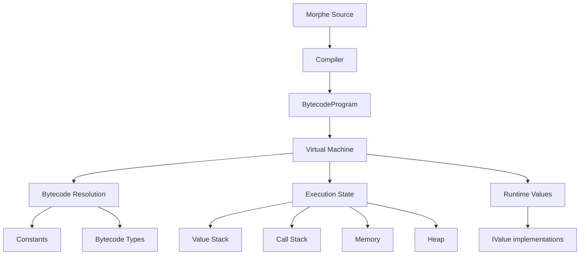

Unlike the bytecode layer, the VM is inherently stateful. A `BytecodeProgram` describes the immutable executable structure of a program, while the VM maintains the mutable state produced while that program is being executed.

The main execution state is represented by the `VirtualMachine` and its `ExecutionContext`:

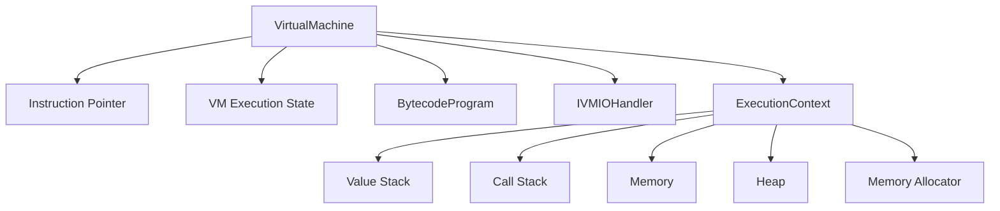

Each call frame contains the runtime scope and closure environment associated with that invocation:

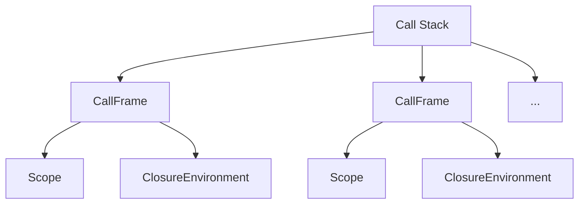

The VM does not redefine the runtime value model. Runtime values such as integers, doubles, booleans, strings, arrays, composites, references, functions, and `null` are provided by the runtime layer and consumed by the VM during execution.

Similarly, the VM does not define the bytecode representation. Instructions, opcode families, constants, bytecode types, and function definitions are provided by the bytecode layer.

This establishes three distinct responsibilities:

| Layer        | Responsibility                                            |
| ------------ | --------------------------------------------------------- |
| **Bytecode** | Defines the immutable representation of compiled programs |
| **Runtime**  | Defines runtime types and values                          |
| **VM**       | Executes bytecode using runtime state and values          |

The VM consequently acts as the execution boundary between these layers.

Its primary responsibility is not to represent programs or values, but to **interpret the bytecode representation and produce the corresponding runtime behavior**.

Execution is also state-driven. The VM can transition between execution states such as:

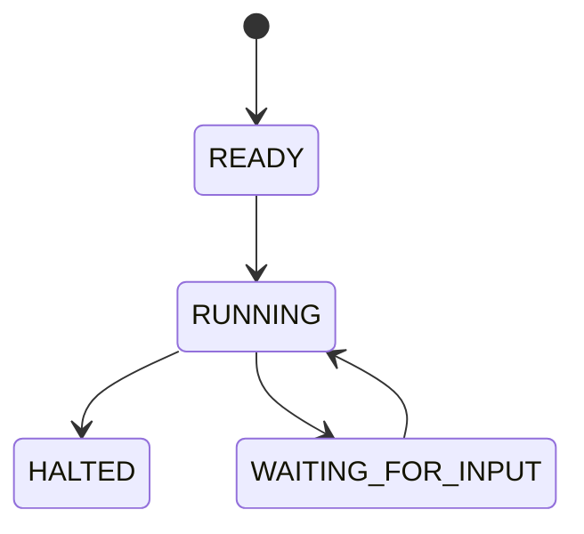

This state model allows the VM to suspend execution when an `INPUT_*` instruction requires external input and resume execution when the corresponding value is provided.

---

## Architecture

The Morphe Virtual Machine is organized into a set of specialized components, each responsible for a distinct part of program execution.

The architecture separates execution control, runtime state, instruction processing, memory management, and resolution responsibilities.

At a high level, the VM can be represented as:

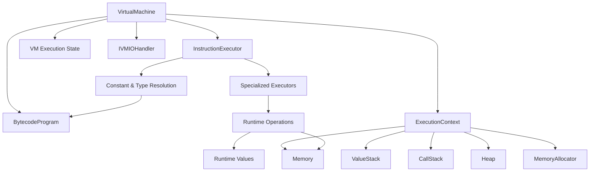

The main components have distinct responsibilities:

| Component                 | Responsibility                                                        |
|---------------------------|-----------------------------------------------------------------------|
| `VirtualMachine`          | Defines the immutable executable representation                       |
| `ExecutionContext`        | Executes bytecode and maintains execution state                       |
| `InstructionExecutor`     | Defines runtime types and values                                      |
| **Specialized Executors** | Defines the immutable executable representation                       |
| **Runtime Operations**    | Executes bytecode and maintains execution state                       |
| `ValueStack`              | Defines runtime types and values                                      |
| `CallStack`               | Defines the immutable executable representation                       |
| `Memory`                  | Executes bytecode and maintains execution state                       |
| `Heap`                    | Defines runtime types and values                                      |
| **Resolution**            | Provides the external output boundary used by VM I/O operations       |
| `IVMIOHandler`            | Provides the external output boundary used by VM I/O operations       |
| **Runtime Values**        | Provide the concrete values consumed and manipulated during execution |

The architecture therefore follows a layered execution path:

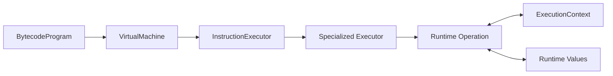

This separation keeps instruction dispatch independent from the implementation of individual runtime operations. Executors determine what operation an opcode represents, while the operation layer performs the corresponding manipulation of the VM's runtime state.

---

### Virtual Machine

`VirtualMachine` is the top-level execution component of the VM.

It coordinates the execution of a `BytecodeProgram` and manages the components required to execute it.

Its responsibilities include:

* Starting and controlling program execution.
* Maintaining the active execution state.
* Managing the instruction pointer.
* Coordinating instruction execution.
* Providing access to VM-level subsystems.
* Managing input suspension and execution resumption.
* Handling execution termination.
* Propagating or handling VM exceptions.

The `VirtualMachine` does not directly implement every opcode operation. Instead, instruction execution is delegated to the appropriate execution components.

Conceptually:

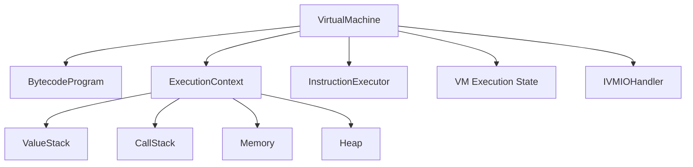

Instruction execution is delegated through the `InstructionExecutor`, which selects the specialized executor associated with the instruction's opcode family:

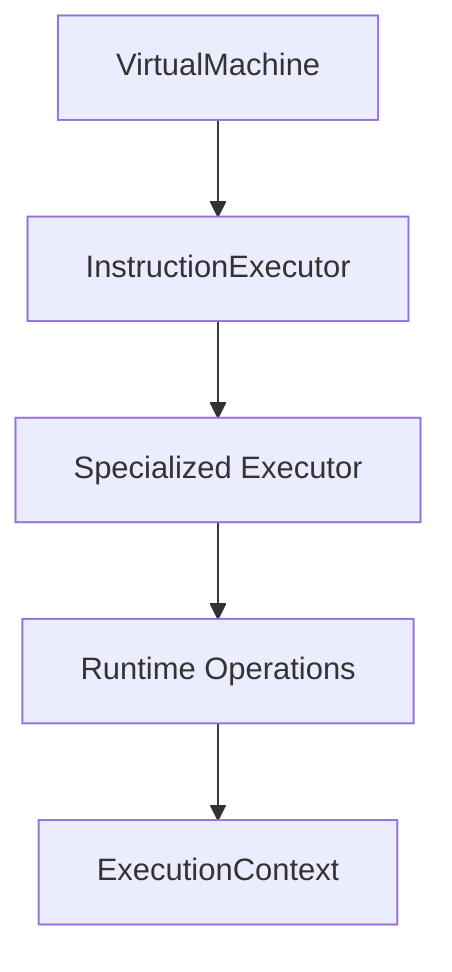

This keeps the VM itself focused on coordinating execution rather than becoming a monolithic instruction interpreter.

---

## Execution Context

The `ExecutionContext` represents the mutable runtime state associated with a single active VM execution.

It provides the shared state required by instruction executors and runtime operations while the `VirtualMachine` coordinates the immutable `BytecodeProgram`, instruction pointer, and execution lifecycle.

The execution architecture can be viewed as:

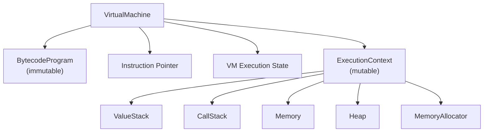

The execution context does not define the semantics of individual instructions. Instead, it provides the mutable state on which the instruction execution layer operates.

### Program and Execution State

A running VM combines two fundamentally different kinds of state.

The `BytecodeProgram` provides the immutable executable representation:

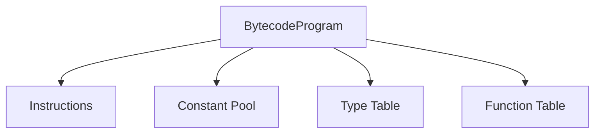

The `ExecutionContext` provides the mutable runtime state required to execute that program:

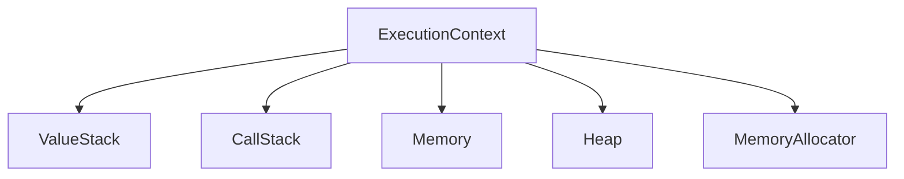

The program describes **what can be executed**, while the VM and execution context represent **the current state of one execution**.

The bytecode program is not modified as instructions execute. Instead, execution produces changes in the VM and its execution context.

For example:

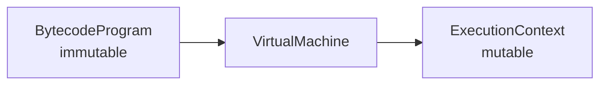

This distinction allows the same bytecode program to serve as the executable representation for multiple executions without sharing their mutable execution state.

### Instruction State

The instruction pointer is maintained by the `VirtualMachine`, rather than by the `ExecutionContext`.

It identifies the current instruction position within the active bytecode program:

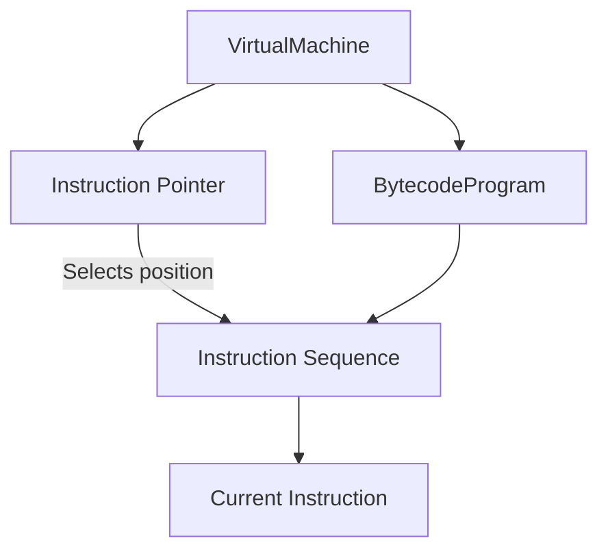

Normal execution advances through the instruction sequence, while control-flow operations may change the next instruction position.

The execution context provides the runtime state affected by these instructions, but instruction fetching and instruction-pointer management remain responsibilities of the `VirtualMachine`.

Instruction fetching, dispatch, and control-flow semantics are defined by the `Execution Model` rather than by the context itself.

### Shared Execution State

The execution context acts as the shared state boundary for the VM's execution subsystems.

Its state can be conceptually divided into several cooperating areas:

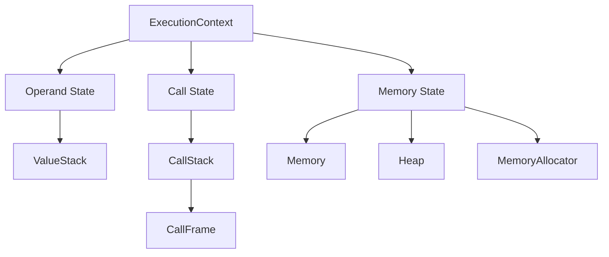

A `CallFrame` contains the scope and closure environment associated with the active function invocation:

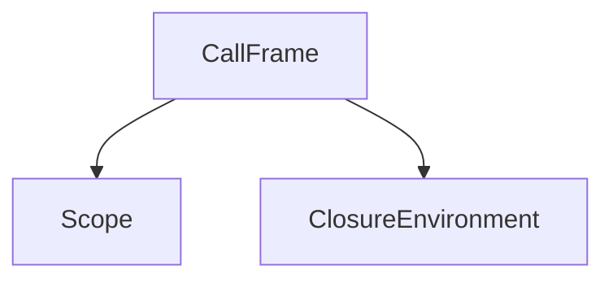

An instruction may affect more than one part of this state.

For example, a function call may involve:

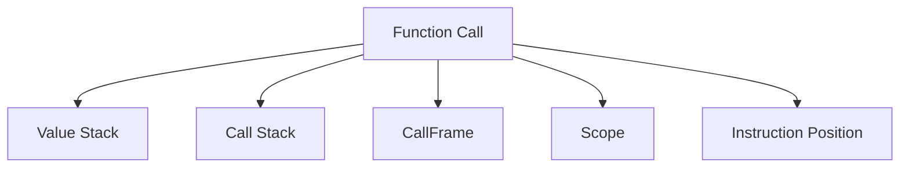

Likewise, an operation involving a heap object may interact with runtime references and heap state:

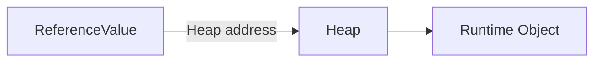

The context provides the common mutable execution state through which these components cooperate.

---

### Instruction Execution

Instruction execution is separated into multiple layers.

The `InstructionExecutor` acts as the central dispatcher for bytecode instructions. It identifies the opcode family and delegates the instruction to the corresponding specialized executor.

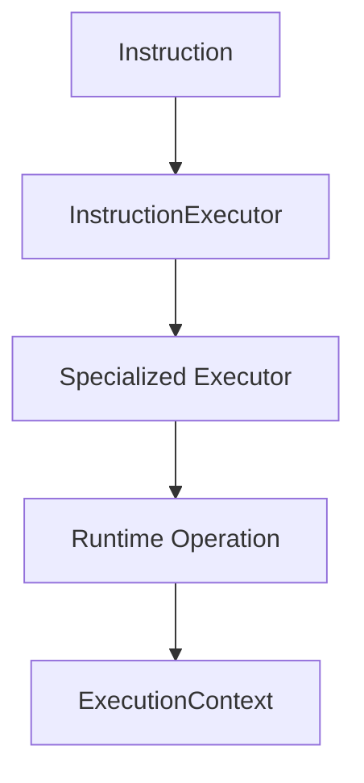

The `InstructionExecutor` is responsible for dispatching instructions rather than implementing their runtime semantics.

Specialized executors group instructions according to their opcode family. The VM currently provides dedicated executors for:

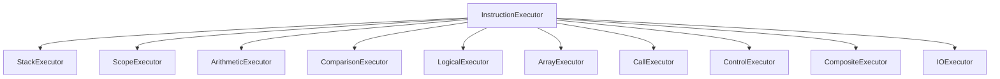

Each specialized executor interprets the instruction and its operands, coordinates the required execution state, and delegates reusable runtime behavior to the corresponding operation layer.

For example, an arithmetic instruction is processed through the following path:

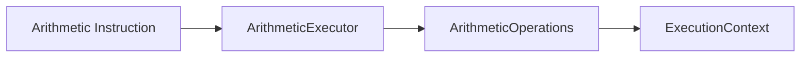

The `ArithmeticExecutor` handles instruction-level concerns such as retrieving operands from the `ValueStack` and placing the result back onto it. `ArithmeticOperations` performs the arithmetic behavior itself.

This separation keeps instruction interpretation distinct from reusable runtime operations. It also allows the operation layer to remain independent of bytecode instruction representation.

Detailed instruction processing is covered by `Instruction Execution`, while the complete execution sequence is described in `Execution Model`.

---

### Memory and State Management

The VM maintains the mutable state required to execute a program.

This state is divided into several cooperating subsystems:

```mermaid
flowchart TD
    Context["ExecutionContext"]

    Stack["ValueStack"]
    Calls["CallStack"]
    Memory["Memory"]
    Heap["Heap"]
    Allocator["MemoryAllocator"]

    Frame["CallFrame"]
    Scope["Scope"]
    Closure["ClosureEnvironment"]

    Context --> Stack
    Context --> Calls
    Context --> Memory
    Context --> Heap
    Context --> Allocator

    Calls --> Frame
    Frame --> Scope
    Frame --> Closure
```

The **operand stack** stores runtime values used by stack-based instructions and operations.

The **call stack** tracks active function invocations through `CallFrame` instances.

Each **call frame** maintains the execution state associated with a function invocation, including its `Scope` and `ClosureEnvironment`.

The **scope** manages variable bindings for the corresponding call frame. These bindings reference storage managed by the VM's memory subsystem.

**Memory** provides the VM-level storage for variable cells, while the **heap** stores dynamically allocated runtime objects such as arrays and composite values.

The **memory allocator** manages the allocation and reuse of addresses used by VM-level memory storage.

The main memory-related components interact as follows:

```mermaid
flowchart TD
    Allocator["MemoryAllocator"]
    Memory["Memory"]
    Cell["VariableCell"]

    Reference["ReferenceValue"]
    Address["Heap Address"]
    Heap["Heap"]
    Object["Runtime Object"]

    Allocator -->|"Allocates addresses"| Memory
    Memory --> Cell

    Reference -->|"Stores"| Address
    Address -->|"Resolves in"| Heap
    Heap --> Object
```

`Memory` and `Heap` represent different forms of runtime storage. Variable cells are stored in VM memory, while dynamically allocated runtime objects are stored in the heap.

A `ReferenceValue` represents access to a heap location through its associated address. The VM resolves that address against the heap when an operation needs to access the referenced object.

Together, these components form the mutable state of an active execution.

They are maintained by the VM and are separate from the immutable bytecode representation.

---

### Resolution

The VM translates bytecode-level representations into runtime-level entities when instructions require runtime values or types.

Resolution is handled by dedicated components that bridge the bytecode and runtime layers.

```mermaid
flowchart TD
    Bytecode["Bytecode Representation"]
    Resolver["VM Resolver"]
    Runtime["Runtime Representation"]

    Bytecode --> Resolver
    Resolver --> Runtime
```

The VM provides specialized resolution components for different bytecode entities.

These components interpret immutable representations defined by the Bytecode module and produce the corresponding runtime representations required during execution.

Resolution does not modify the bytecode representation. It only provides the runtime entities required by the execution layer.

#### Constant Resolution

`ConstantResolver` resolves bytecode constants into their corresponding runtime values.

Conceptually:

```mermaid
flowchart LR
    Pool["Bytecode Constant Pool"]
    Constant["IConstant"]
    Resolver["ConstantResolver"]
    Value["IValue"]

    Pool -->|"Provides"| Constant
    Constant --> Resolver
    Resolver --> Value
```

The bytecode layer defines the representation of constants through `IConstant`, while the runtime layer defines the corresponding `IValue` representations.

The VM performs this conversion when an instruction requires a runtime value. This allows instructions and runtime operations to work with runtime values without depending directly on the bytecode constant representation.

#### Type Resolution

`TypeResolver` resolves bytecode-level types into their corresponding runtime type representations.

```mermaid
flowchart LR
    BytecodeType["IBytecodeType"]
    Resolver["TypeResolver"]
    RuntimeType["Runtime Type"]

    BytecodeType --> Resolver
    Resolver --> RuntimeType
```

This preserves the separation between bytecode types and runtime types.

The bytecode layer describes type information encoded in a compiled program, while the runtime layer provides the type representations required during execution.

Resolution therefore acts as a bridge between the immutable bytecode model and the runtime model without coupling either layer to VM-specific execution state.

---

### Architectural Boundaries

The VM maintains explicit boundaries between the bytecode, runtime, and execution layers.

```mermaid
flowchart TD
    Bytecode["Bytecode Layer<br/><br/>BytecodeProgram<br/>Instructions<br/>Constants<br/>Types<br/>Function Definitions"]

    VM["VM Layer<br/><br/>Execution<br/>State<br/>Memory<br/>Dispatch<br/>Executors<br/>Operations<br/>Control Flow"]

    Runtime["Runtime Layer<br/><br/>Types<br/>Values<br/>References<br/>Runtime Objects"]

    Bytecode -->|"Consumed & Resolved"| VM
    VM -->|"Uses"| Runtime
```

Each layer has a distinct responsibility.

| Layer        | Responsibility                                                 |
| ------------ | -------------------------------------------------------------- |
| **Bytecode** | Defines the immutable executable representation                |
| **VM**       | Executes bytecode and maintains execution state                |
| **Runtime**  | Defines runtime types, values, references, and runtime objects |

The VM consumes bytecode structures and operates on runtime entities, but it does not duplicate the responsibilities of either layer.

For example:

* The VM resolves constants; it does not redefine the constant-pool representation.
* The VM resolves bytecode types; it does not redefine the bytecode type system.
* The VM manipulates runtime values; it does not own their definitions.
* The VM manages memory and heap state; runtime references represent access to heap locations.
* The VM executes instructions; the bytecode layer defines their representation and opcode families.

This separation keeps the architecture modular and allows the Bytecode and Runtime modules to remain independent of the VM's execution-specific state and control flow.

The resulting architecture positions the VM as the **execution bridge between compiled bytecode and runtime behavior**, while each surrounding layer retains a clearly defined responsibility.

---

## Execution Model

The Morphe Virtual Machine executes a `BytecodeProgram` by repeatedly fetching, dispatching, and executing instructions while maintaining the current execution state.

Execution is coordinated by the `VirtualMachine`, which maintains the instruction pointer and execution state, together with the mutable state contained in the active `ExecutionContext`.

At a high level, the execution cycle is:

```mermaid
flowchart TD
    IP["Instruction Pointer"]
    Fetch["Instruction Fetch"]
    Dispatch["Instruction Dispatch"]
    Execute["Instruction Execute"]
    Update["Update Execution State"]

    IP --> Fetch
    Fetch --> Dispatch
    Dispatch --> Execute
    Execute --> Update
    Update -->|"Next Instruction"| IP
```

The instruction pointer identifies the current position within the immutable `BytecodeProgram`. Instruction fetching obtains the instruction at that position, dispatching selects the appropriate specialized executor, and execution applies the instruction's behavior to the current VM state.

During instruction execution, the selected executor may modify different parts of the execution state, including the value stack, memory, heap, call stack, instruction pointer, or execution state.

Some instructions may also temporarily suspend execution. For example, an `INPUT_*` instruction places the VM into `WAITING_FOR_INPUT` rather than continuing immediately with the next instruction.

The execution lifecycle can therefore be represented as:

```mermaid
stateDiagram-v2
    [*] --> READY
    READY --> RUNNING

    RUNNING --> WAITING_FOR_INPUT
    WAITING_FOR_INPUT --> RUNNING

    RUNNING --> HALTED
    HALTED --> [*]
```

Under normal execution, the cycle continues until the VM reaches a terminating condition such as `HALT` or the end of the executable program. When input is required, execution pauses in `WAITING_FOR_INPUT` and resumes after input is provided.

If an execution error occurs, the corresponding VM exception interrupts the normal instruction cycle and is propagated according to the VM's error-handling model.

The execution model therefore consists of two cooperating mechanisms:

* **Instruction cycling**, which determines how bytecode instructions are fetched, dispatched, and executed.
* **Execution state management**, which determines whether the VM is ready, running, waiting for external input, or halted.

---
### Instruction Pointer

The instruction pointer identifies the current position within the instruction sequence being executed.

It is maintained by the `VirtualMachine` and determines which instruction is fetched from the active `BytecodeProgram`.

Conceptually:

```mermaid
flowchart TD
    Program["BytecodeProgram"]
    Instructions["Instruction Sequence"]
    IP["Instruction Pointer"]
    Instruction["Current Instruction"]

    Program --> Instructions
    IP -->|"Selects position"| Instructions
    Instructions --> Instruction
```

During sequential execution, the instruction pointer advances to the next instruction position.

Control-flow instructions may instead modify the instruction pointer, allowing execution to continue from another position in the bytecode program. Jump instructions are a direct example of this behavior.

The instruction pointer therefore represents the current execution position and provides the basis for both sequential and non-sequential control flow.

---

### Instruction Fetch

Instruction fetching retrieves the instruction located at the current instruction pointer.

The VM uses the active `BytecodeProgram` as the immutable source of instructions.

Conceptually:

```mermaid
flowchart TD
    VM["VirtualMachine"]
    IP["Instruction Pointer"]
    Program["BytecodeProgram"]
    Instructions["Instruction Sequence"]
    Instruction["Fetched Instruction"]

    VM --> IP
    VM --> Program
    IP -->|"Selects position"| Instructions
    Program --> Instructions
    Instructions --> Instruction
```

The fetched instruction contains its opcode and operands.

Before the instruction can be fetched, the VM must ensure that the requested instruction position is valid. An invalid instruction position is treated as an execution error.

Instruction fetching only reads from the active `BytecodeProgram`; it does not modify the program or its instruction sequence.

---

### Instruction Dispatch

Once an instruction has been fetched, the VM determines which executor is responsible for its opcode family.

The `InstructionExecutor` acts as the central dispatch point.

```mermaid
flowchart TD
    Instruction["Fetched Instruction"]
    Dispatcher["InstructionExecutor"]

    Stack["StackExecutor"]
    Scope["ScopeExecutor"]
    Arithmetic["ArithmeticExecutor"]
    Comparison["ComparisonExecutor"]
    Logical["LogicalExecutor"]
    Array["ArrayExecutor"]
    Call["CallExecutor"]
    Control["ControlExecutor"]
    Composite["CompositeExecutor"]
    IO["IOExecutor"]

    Instruction --> Dispatcher

    Dispatcher --> Stack
    Dispatcher --> Scope
    Dispatcher --> Arithmetic
    Dispatcher --> Comparison
    Dispatcher --> Logical
    Dispatcher --> Array
    Dispatcher --> Call
    Dispatcher --> Control
    Dispatcher --> Composite
    Dispatcher --> IO
```

The `InstructionExecutor` selects the specialized executor associated with the instruction's opcode family. The selected executor then interprets the instruction operands, coordinates the required execution state, and delegates reusable behavior to the appropriate runtime operation.

The dispatch process can therefore be summarized as:

```mermaid
flowchart LR
    Instruction["Fetched Instruction"]
    Dispatch["InstructionExecutor"]
    Executor["Specialized Executor"]
    Operation["Runtime Operation"]
    State["Execution State"]

    Instruction --> Dispatch
    Dispatch --> Executor
    Executor --> Operation
    Operation --> State
```

This separates the concerns of:

1. Identifying the current instruction.
2. Selecting its specialized executor.
3. Interpreting its operands and performing the required operation.
4. Updating the affected execution state.

If an instruction cannot be dispatched to a supported executor, the VM reports an internal VM error rather than silently ignoring the instruction.

---

### Execution State

Execution state is the mutable information required to continue running the current bytecode program.

The `VirtualMachine` coordinates the immutable program with the mutable state required during execution:

```mermaid
flowchart TD
    VM["VirtualMachine"]

    Program["BytecodeProgram<br/>(immutable)"]
    IP["Instruction Pointer"]
    State["VM Execution State"]
    Context["ExecutionContext"]

    Stack["ValueStack"]
    Calls["CallStack"]
    Memory["Memory"]
    Allocator["MemoryAllocator"]
    Heap["Heap"]

    VM --> Program
    VM --> IP
    VM --> State
    VM --> Context

    Context --> Stack
    Context --> Calls
    Context --> Memory
    Context --> Allocator
    Context --> Heap
```

The bytecode program remains immutable throughout execution.

The remaining components represent state that changes as instructions execute.

For example:

* The instruction pointer changes as execution advances or control-flow instructions redirect execution.
* The value stack changes as values are pushed and consumed.
* The call stack changes when functions are invoked and return.
* Call frames and their associated scopes change as function execution progresses.
* Memory and heap state change as runtime storage is allocated, accessed, modified, and released.

The VM therefore executes a fixed program representation together with mutable execution state.

---

### Sequential Execution

In the absence of control-flow changes, instructions execute sequentially.

Given instructions:

```text
I0
I1
I2
I3
I4
```

the VM normally processes them in order:

```mermaid
flowchart LR
    I0["I0"] --> I1["I1"]
    I1 --> I2["I2"]
    I2 --> I3["I3"]
    I3 --> I4["I4"]
```

After an instruction completes, execution normally continues at the next instruction position.

This provides the default execution behavior for ordinary stack, arithmetic, comparison, logical, array, scope, and other non-branching instructions.

Sequential execution is therefore the baseline from which branching, jumping, function calls, and returns alter the normal execution flow.

---

### Control-Flow Changes

Some instructions modify the normal sequential execution path.

Control-flow operations may cause execution to:

* Jump to another instruction.
* Branch according to a runtime condition.
* Invoke another function.
* Return from the current function.
* Terminate execution.

Conceptually:

```mermaid
flowchart TD
    Current["Current Instruction"]
    Control["Control Flow"]

    Next["Sequential<br/>Next Instruction"]
    Jump["Jump Target"]
    Call["Function Call"]
    Return["Return"]
    Halt["Execution Termination"]

    Current --> Control

    Control --> Next
    Control --> Jump
    Control --> Call
    Control --> Halt

    Call --> Return
    Return --> Next
```

Control-flow instructions therefore affect the instruction pointer rather than simply allowing it to advance to the next instruction.

Conditional control flow may additionally consume runtime values from the operand stack or inspect other execution state to determine the next instruction position.

---

### Function Invocation

Function invocation creates a new `CallFrame` within the current `ExecutionContext`.

A function is represented at runtime by a `FunctionValue`, which identifies the target function through its function identifier.

The VM resolves that identifier against the active bytecode program and establishes the state required for the invocation.

Conceptually:

```mermaid
flowchart TD
    Function["FunctionValue"]
    ID["Function Identifier"]
    Table["Function Table"]
    Definition["FunctionDefinition"]
    Frame["CallFrame"]
    Execution["Function Execution"]

    Function --> ID
    ID --> Table
    Table --> Definition
    Definition --> Frame
    Frame --> Execution
```

The call stack tracks active function invocations through `CallFrame` instances.

A call frame contains the execution state required by the called function, including its `Scope` and `ClosureEnvironment`, and provides the information needed to resume the caller when the function returns.

Function invocation therefore modifies multiple parts of execution state:

```mermaid
flowchart TD
    Call["Function Call"]
    Resolve["Resolve Function"]
    Frame["Create CallFrame"]
    Scope["Establish Function Scope"]
    Transfer["Transfer Execution"]
    Entry["Begin at Function Entry"]

    Call --> Resolve
    Resolve --> Frame
    Frame --> Scope
    Scope --> Transfer
    Transfer --> Entry
```

When the function returns, the VM removes the active call frame and continues execution using the caller's frame and return location.

---

### Execution Termination

Execution terminates when there is no further instruction to execute or when an explicit termination condition is reached.

Normal termination represents a completed execution of the bytecode program and results in the `HALTED` execution state.

Execution may also be interrupted by an exception. In that case, normal instruction execution does not continue and the corresponding VM exception is propagated according to the VM's error-handling model.

The distinction can be represented as:

```mermaid
flowchart TD
    Execution["Execution"]

    Normal["Normal Completion"]
    Exception["Execution Error"]

    Halted["HALTED"]
    Aborted["Aborted"]

    Execution --> Normal
    Execution --> Exception

    Normal --> Halted
    Exception --> Aborted
```

The VM must account for failures encountered during execution, such as invalid instruction positions, unsupported instructions, invalid memory access, stack violations, or invalid runtime values.

Such failures are represented through the VM exception hierarchy.

---

### Execution and Runtime Values

Instructions operate on runtime values rather than directly manipulating source-level language constructs.

The VM consumes and produces implementations of `IValue` while executing bytecode.

For example:

```mermaid
flowchart LR
    Instruction["Instruction"]
    Executor["Executor"]
    Operation["Runtime Operation"]
    Input["Runtime Values"]
    Result["Runtime Value"]

    Instruction --> Executor
    Executor --> Operation
    Input --> Operation
    Operation --> Result
```

Runtime operations may validate their input values, perform the requested behavior, and produce runtime values as results.

Runtime values may represent primitives, arrays, composites, references, functions, or `null`.

The VM is responsible for performing execution-specific operations over these values, while the Runtime layer remains responsible for defining the values and their representations.

This separation allows the VM to execute operations without coupling the execution engine to the internal representation of every runtime value.

---

### Execution Pipeline

The complete execution process can be summarized as a pipeline coordinated by the `VirtualMachine`:

```mermaid
flowchart TD
    VM["VirtualMachine"]
    Program["BytecodeProgram"]
    IP["Instruction Pointer"]
    Fetch["Instruction Fetch"]
    Dispatch["Instruction Dispatch"]
    Executor["Specialized Executor"]
    Operation["Runtime Operation"]
    State["Execution State"]

    VM --> Program
    VM --> IP
    IP --> Fetch
    Program --> Fetch
    Fetch --> Dispatch
    Dispatch --> Executor
    Executor --> Operation
    Operation --> State
    State --> VM
```

The mutable execution state affected by an instruction is maintained through the active `ExecutionContext`:

```mermaid
flowchart TD
    Operation["Runtime Operation"]
    Context["ExecutionContext"]

    Stack["ValueStack"]
    Calls["CallStack"]
    Memory["Memory"]
    Heap["Heap"]
    Allocator["MemoryAllocator"]

    Operation --> Context
    Context --> Stack
    Context --> Calls
    Context --> Memory
    Context --> Heap
    Context --> Allocator
```

A typical instruction therefore passes through several architectural layers before its effects become part of the current execution state:

```mermaid
flowchart LR
    Instruction["Fetched Instruction"]
    Dispatcher["InstructionExecutor"]
    Executor["Specialized Executor"]
    Operation["Runtime Operation"]
    State["Runtime / Execution State"]

    Instruction --> Dispatcher
    Dispatcher --> Executor
    Executor --> Operation
    Operation --> State
```

The execution model can consequently be summarized as a repeating cycle:

```mermaid
flowchart LR
    Fetch["Fetch"]
    Dispatch["Dispatch"]
    Execute["Execute"]
    Update["Update State"]

    Fetch --> Dispatch
    Dispatch --> Execute
    Execute --> Update
    Update -->|"Next instruction"| Fetch
```

Control-flow operations may replace the normal next-instruction transition by modifying the instruction pointer. Function calls temporarily transfer execution to another function, while returns restore the caller's frame and execution position.

The VM continues this process until execution completes normally, waits for external input, or an execution error interrupts the normal instruction cycle.

---

## Execution Context

The `ExecutionContext` represents the mutable runtime state associated with a single active VM execution.

It provides the shared state on which instruction execution operates, while the `VirtualMachine` maintains the active `BytecodeProgram`, instruction pointer, and execution state.

The execution context can be viewed as the mutable state boundary of an execution:

```mermaid
flowchart TD
    VM["VirtualMachine"]

    Program["BytecodeProgram<br/>(immutable)"]
    IP["Instruction Pointer"]
    State["VM Execution State"]
    Context["ExecutionContext<br/>(mutable)"]

    Stack["ValueStack"]
    Calls["CallStack"]
    Memory["Memory"]
    Heap["Heap"]
    Allocator["MemoryAllocator"]

    VM --> Program
    VM --> IP
    VM --> State
    VM --> Context

    Context --> Stack
    Context --> Calls
    Context --> Memory
    Context --> Heap
    Context --> Allocator
```

The execution context does not define the semantics of individual instructions. Instead, it provides the mutable state required by the instruction execution layer.

### Program and Execution State

A running VM combines two fundamentally different kinds of state.

The `BytecodeProgram` provides the immutable executable representation:

```mermaid
flowchart TD
    Program["BytecodeProgram<br/>(immutable)"]

    Instructions["Instructions"]
    Constants["Constant Pool"]
    Types["Type Table"]
    Functions["Function Table"]

    Program --> Instructions
    Program --> Constants
    Program --> Types
    Program --> Functions
```

The `VirtualMachine` maintains execution-control state:

```mermaid
flowchart TD
    VM["VirtualMachine"]

    Program["BytecodeProgram"]
    IP["Instruction Pointer"]
    State["VM Execution State"]
    Context["ExecutionContext"]

    VM --> Program
    VM --> IP
    VM --> State
    VM --> Context
```

The `ExecutionContext` maintains the mutable runtime state required by the active execution:

```mermaid
flowchart TD
    Context["ExecutionContext"]

    Stack["ValueStack"]
    Calls["CallStack"]
    Memory["Memory"]
    Heap["Heap"]
    Allocator["MemoryAllocator"]

    Context --> Stack
    Context --> Calls
    Context --> Memory
    Context --> Heap
    Context --> Allocator
```

The program describes **what can be executed**, while the VM and its execution context represent **the current state of one execution**.

The bytecode program is not modified as instructions execute. Instead, execution changes the mutable state maintained by the VM and its context.

This distinction allows the same immutable `BytecodeProgram` to serve as the executable representation for multiple executions without sharing their mutable execution state.

### Instruction State

The instruction pointer is maintained by the `VirtualMachine`, not by the `ExecutionContext`.

It identifies the current instruction position within the active bytecode program:

```mermaid
flowchart TD
    VM["VirtualMachine"]
    IP["Instruction Pointer"]
    Program["BytecodeProgram"]
    Instructions["Instruction Sequence"]
    Instruction["Current Instruction"]

    VM --> IP
    VM --> Program
    IP -->|"Selects position"| Instructions
    Program --> Instructions
    Instructions --> Instruction
```

Normal execution advances the instruction pointer through the instruction sequence, while control-flow operations may change its position.

Instruction fetching, dispatch, and control-flow semantics belong to the `Execution Model` rather than to the `ExecutionContext`.

### Shared Execution State

The execution context acts as the shared state boundary for the VM's runtime subsystems.

Its state can be conceptually divided into several cooperating areas:

```mermaid
flowchart TD
    Context["ExecutionContext"]

    Operand["Operand State"]
    Stack["ValueStack"]

    Call["Call State"]
    Calls["CallStack"]
    Frame["CallFrame"]

    MemoryState["Memory State"]
    Memory["Memory"]
    Heap["Heap"]
    Allocator["MemoryAllocator"]

    Context --> Operand
    Operand --> Stack

    Context --> Call
    Call --> Calls
    Calls --> Frame

    Context --> MemoryState
    MemoryState --> Memory
    MemoryState --> Heap
    MemoryState --> Allocator
```

A `CallFrame` contains the function-local execution state associated with an active invocation, including its `Scope` and `ClosureEnvironment`:

```mermaid
flowchart TD
    Frame["CallFrame"]
    Scope["Scope"]
    Closure["ClosureEnvironment"]

    Frame --> Scope
    Frame --> Closure
```

An instruction may affect more than one part of the shared execution state.

For example, a function call may involve:

```mermaid
flowchart TD
    Call["Function Call"]

    Stack["ValueStack"]
    Calls["CallStack"]
    Frame["CallFrame"]
    Scope["Scope"]
    IP["Instruction Pointer"]

    Call --> Stack
    Call --> Calls
    Call --> Frame
    Frame --> Scope
    Call --> IP
```

Likewise, an operation involving a heap object may use a runtime reference to access an object stored in the heap:

```mermaid
flowchart LR
    Reference["ReferenceValue"]
    Address["Heap Address"]
    Heap["Heap"]
    Object["Runtime Object"]

    Reference --> Address
    Address --> Heap
    Heap --> Object
```

The context provides the common mutable runtime state through which these components cooperate.

### Execution Context and Executors

Specialized executors operate against the shared state provided by the execution context.

The relationship can be represented as:

```mermaid
flowchart TD
    Instruction["Instruction"]
    Dispatcher["InstructionExecutor"]
    Executor["Specialized Executor"]
    Context["ExecutionContext"]

    Instruction --> Dispatcher
    Dispatcher --> Executor
    Executor --> Context
```

The executor determines **what operation should be performed**, while the execution context provides **the mutable state required to perform it**.

For example, a stack instruction operates on the shared value stack:

```mermaid
flowchart TD
    StackExecutor["StackExecutor"]
    Context["ExecutionContext"]
    Stack["ValueStack"]

    StackExecutor --> Context
    Context --> Stack
```

A scope instruction operates on the scope associated with the active call frame:

```mermaid
flowchart TD
    ScopeExecutor["ScopeExecutor"]
    Context["ExecutionContext"]
    Calls["CallStack"]
    Frame["CallFrame"]
    Scope["Scope"]

    ScopeExecutor --> Context
    Context --> Calls
    Calls --> Frame
    Frame --> Scope
```

Memory-related operations access the memory and heap state maintained by the context:

```mermaid
flowchart TD
    Operation["Runtime Operation"]
    Context["ExecutionContext"]

    Memory["Memory"]
    Heap["Heap"]
    Allocator["MemoryAllocator"]

    Operation --> Context
    Context --> Memory
    Context --> Heap
    Context --> Allocator
```

This shared-state model prevents specialized executors from maintaining independent copies of execution state.

Instead, all instruction families operate against the same `ExecutionContext` associated with the active VM execution.

### Execution Context Lifetime

An `ExecutionContext` represents the mutable runtime state associated with a VM execution.

The `VirtualMachine` establishes the required execution state before starting a program and resets the relevant state when a new execution begins.

Conceptually:

```mermaid
flowchart TD
    Start["Execution Start"]
    Initialize["Initialize Execution State"]
    Execute["Instruction Execution"]
    Changes["State Changes"]
    Termination["Execution Termination"]

    Start --> Initialize
    Initialize --> Execute
    Execute --> Changes
    Changes --> Execute
    Execute --> Termination
```

During execution, the context continuously reflects the current mutable state of the running program.

State may change as instructions execute, functions are invoked and returned, variables are accessed, and runtime objects are allocated or modified.

The context is therefore an execution-state container rather than a persistent representation of the program itself.

The immutable `BytecodeProgram` can be used for multiple executions while execution state remains associated with the VM execution:

```mermaid
flowchart TD
    Program["BytecodeProgram<br/>(immutable)"]

    VM["VirtualMachine"]

    ContextA["Execution State A"]
    ContextB["Execution State B"]

    ExecutionA["Execution A"]
    ExecutionB["Execution B"]

    Program --> VM
    VM --> ContextA
    VM --> ContextB

    ContextA --> ExecutionA
    ContextB --> ExecutionB
```

Each execution must maintain its own mutable state. Stack contents, active calls, scopes, memory state, heap state, and other execution-specific information must not become part of the immutable bytecode representation.

### Responsibility Boundary

The `ExecutionContext` is responsible for representing mutable execution state, but it does not own every responsibility involved in executing a program.

The architectural boundaries are:

| Component             | Responsibility                                                               |
| --------------------- | ---------------------------------------------------------------------------- |
| `BytecodeProgram`     | Immutable executable representation                                          |
| `ExecutionContext`    | Mutable runtime state of an active execution                                 |
| `InstructionExecutor` | Instruction dispatch                                                         |
| Specialized Executors | Opcode-family-specific instruction handling                                  |
| Operations            | Concrete runtime operations                                                  |
| Runtime               | Runtime types and values                                                     |
| Resolvers             | Translation between bytecode and runtime representations                     |
| `VirtualMachine`      | Execution lifecycle, instruction position, execution state, and coordination |

The context therefore does not:

* Define bytecode instructions.
* Define opcode semantics independently of the executors and operations.
* Replace runtime value implementations.
* Define the bytecode type system.
* Own the format of the constant pool.
* Manage the overall execution lifecycle.

Instead, it provides the shared mutable state required by the execution layer.

The architectural relationship can be summarized as:

```mermaid
flowchart TD
    Program["BytecodeProgram<br/>(immutable)"]
    VM["VirtualMachine"]
    Context["ExecutionContext<br/>(mutable state)"]
    Executor["Instruction Layer"]
    Specialized["Specialized Executors"]
    Operations["Runtime Operations"]
    Resolvers["Resolvers"]
    Runtime["Runtime"]
    
    Program --> VM
    VM --> Context
    VM --> Executor
    Executor --> Specialized
    Specialized --> Operations
    Executor --> Resolvers
    Operations --> Context
    Resolvers --> Runtime
    Operations --> Runtime
```

The `ExecutionContext` is therefore the **state boundary of a running Morphe execution**: it contains the mutable runtime state required by the execution layer while leaving program representation, runtime value definitions, instruction dispatch, operation semantics, and execution lifecycle to their respective components.

---

## Stack and Call Management

The VM uses two related but distinct stack structures to manage execution:

* The **value stack** stores runtime values used by instructions and operations.
* The **call stack** tracks active function invocations.
* A **call frame** represents the execution state associated with one active function invocation.

Together, these structures provide the stack-based execution model used by the VM.

```mermaid
flowchart TD
    Execution["Execution"]

    ValueStack["ValueStack"]
    CallStack["CallStack"]
    RuntimeValues["Runtime Values"]
    Frame["CallFrame"]

    Execution --> ValueStack
    Execution --> CallStack

    ValueStack --> RuntimeValues
    CallStack --> Frame
```

The value stack and call stack serve different purposes and should not be treated as interchangeable state.

### Value Stack

`ValueStack` stores runtime values temporarily during instruction execution.

It is the primary operand storage mechanism for stack-based bytecode instructions.

Conceptually:

```mermaid
flowchart TD
    Top["Top Value"]
    Value1["Value"]
    Value2["Value"]
    Bottom["Bottom Value"]

    Top --> Value1
    Value1 --> Value2
    Value2 --> Bottom
```

Instructions manipulate the stack by pushing values onto it and consuming values from it.

For example, an arithmetic expression can be represented as:

```text
PUSH 10
PUSH 20
ADD
```

The corresponding stack transitions are:

```mermaid
flowchart LR
    A["10"]
    B["20<br/>10"]
    C["30"]

    A -->|"PUSH 20"| B
    B -->|"ADD"| C
```

The operands are consumed by the operation and replaced by its result.

The value stack stores `IValue` instances rather than bytecode constants.

Instructions that load constants therefore resolve the corresponding bytecode constant into a runtime value before placing it on the stack.

#### Stack Ownership

The value stack belongs to the active execution state.

It is maintained by the `ExecutionContext` and is not part of the immutable `BytecodeProgram`.

```mermaid
flowchart TD
    Program["BytecodeProgram<br/>(immutable)"]
    Context["ExecutionContext"]
    Stack["ValueStack<br/>(mutable)"]

    Program -.->|"Provides executable representation"| Context
    Context --> Stack
```

This allows the same bytecode program to be executed without sharing operand-stack contents between independent execution states.

#### Stack and Runtime Values

The stack operates on runtime values.

Conceptually:

```mermaid
flowchart LR
    Bytecode["Bytecode Constant"]
    Resolver["ConstantResolver"]
    Value["IValue"]
    Stack["ValueStack"]

    Bytecode --> Resolver
    Resolver --> Value
    Value --> Stack
```

Values placed on the stack may represent primitive values, arrays, composites, references, functions, or `null`.

The value stack therefore acts as the common operand channel between instructions and runtime operations.

### Call Stack

`CallStack` tracks the active function invocations during execution.

Unlike the value stack, the call stack does not primarily store arbitrary runtime operands. Instead, it stores `CallFrame` instances representing active invocation state.

```mermaid
flowchart TD
    Current["Current CallFrame"]
    Caller["Caller CallFrame"]
    Root["Root CallFrame"]

    Current --> Caller
    Caller --> Root
```

When a function is invoked, a new frame is pushed onto the call stack.

When that function returns, its frame is removed.

```mermaid
flowchart TD
    Call["Function Call"]
    Push["Push CallFrame"]
    Execute["Execute Function"]
    Pop["Pop CallFrame"]
    Resume["Resume Caller"]

    Call --> Push
    Push --> Execute
    Execute --> Pop
    Pop --> Resume
```

The call stack therefore represents the dynamic call hierarchy of the current execution.

#### Call Frames

A `CallFrame` contains the state associated with one active function invocation.

This includes the function's active `Scope` and `ClosureEnvironment`, together with the information required to resume the caller when the function returns.

```mermaid
flowchart TD
    Frame["CallFrame"]
    Scope["Scope"]
    Closure["ClosureEnvironment"]

    Frame --> Scope
    Frame --> Closure
```

#### Nested Calls

Nested function calls produce multiple active frames:

```text
main()
  │
  └── foo()
        │
        └── bar()
```

The corresponding call stack can be represented as:

```mermaid
flowchart TD
    Bar["bar() CallFrame<br/>(current)"]
    Foo["foo() CallFrame"]
    Main["main() CallFrame"]

    Bar --> Foo
    Foo --> Main
```

This structure naturally supports nested and recursive function calls.

A recursive function creates additional frames for each active invocation:

```text
factorial()
    │
    └── factorial()
          │
          └── factorial()
                │
                └── ...
```

Each invocation has its own `CallFrame`, even when multiple frames correspond to the same function definition.

### Call Frames

`CallFrame` represents the execution state associated with one active function invocation.

A call frame belongs to the call stack and contains the state required while the corresponding function invocation is active.

Conceptually:

```mermaid
flowchart TD
    Frame["CallFrame"]
    Return["Return Address"]
    Scope["Scope"]
    Closure["ClosureEnvironment"]

    Frame --> Return
    Frame --> Scope
    Frame --> Closure
```

The `CallFrame` maintains the invocation-specific state, while the `VirtualMachine` maintains the global instruction pointer used to control instruction execution.

When a function is called, the VM creates and pushes a new call frame before transferring execution to the callee.

```mermaid
flowchart TD
    Caller["Caller"]
    Call["CALL"]
    Create["Create CallFrame"]
    Push["Push onto CallStack"]
    Callee["Execute Callee"]

    Caller --> Call
    Call --> Create
    Create --> Push
    Push --> Callee
```

When the function returns, the active frame is removed and execution continues at the return address associated with the caller's execution.

```mermaid
flowchart TD
    Callee["Callee"]
    Return["RETURN"]
    Remove["Remove active CallFrame"]
    Address["Use return address"]
    Resume["Resume Caller"]

    Callee --> Return
    Return --> Remove
    Remove --> Address
    Address --> Resume
```

#### Frame Isolation

Each function invocation receives its own `CallFrame`.

This is particularly important for recursive calls.

For example:

```text
functionA()
    │
    └── functionA()
          │
          └── functionA()
```

Each active invocation is represented by a separate frame:

```mermaid
flowchart TD
    Frame3["Frame: A (3)<br/>current"]
    Frame2["Frame: A (2)"]
    Frame1["Frame: A (1)"]

    Frame3 --> Frame2
    Frame2 --> Frame1
```

Each frame maintains its own invocation-specific state, including its own `Scope` and `ClosureEnvironment`.

This prevents one invocation from replacing the scope or closure state belonging to another active invocation.

The instruction pointer itself remains a property of the `VirtualMachine`; the frame contributes the return information required when control returns to the caller.

#### Root Frame

The VM establishes a root `CallFrame` as the initial frame of the execution context.

The root frame differs from ordinary function frames because it represents the base of the active call stack and has no caller above it.

Conceptually:

```mermaid
flowchart TD
    Current["Current CallFrame"]
    Caller["Caller CallFrame"]
    Root["Root CallFrame"]

    Current --> Caller
    Caller --> Root
```

The root frame provides the initial scope and closure environment for the execution context.

Returning beyond the root frame is therefore not an ordinary caller-resumption operation. The VM handles this condition according to its call and execution semantics.

### Relationship Between the Stacks

The value stack and call stack cooperate during execution, but they have different responsibilities.

```mermaid
flowchart TD
    Context["ExecutionContext"]

    ValueStack["ValueStack"]
    CallStack["CallStack"]
    Frame["CallFrame"]
    Scope["Scope"]
    Closure["ClosureEnvironment"]
    Values["Runtime Values"]

    Context --> ValueStack
    Context --> CallStack

    ValueStack --> Values

    CallStack --> Frame
    Frame --> Scope
    Frame --> Closure
```

A function invocation can therefore affect both structures.

For example, a function call may consume the function value and arguments from the value stack, create a new call frame, push that frame onto the call stack, and transfer execution to the callee.

```mermaid
flowchart TD
    Call["CALL"]
    Values["Function / Arguments<br/>on ValueStack"]
    Frame["Create CallFrame"]
    Stack["Push CallFrame<br/>onto CallStack"]
    Transfer["Transfer execution<br/>to Callee"]

    Call --> Values
    Call --> Frame
    Frame --> Stack
    Stack --> Transfer
```

When the function returns, its frame is removed from the call stack. When a return value is produced, it becomes available through the value-stack mechanism defined by the VM's calling convention.

The two structures consequently form complementary parts of execution state:

| Structure    | Primary Responsibility                      |
| ------------ | ------------------------------------------- |
| `ValueStack` | Runtime operands and intermediate values    |
| `CallStack`  | Active function invocations                 |
| `CallFrame`  | State associated with one active invocation |

The distinction is fundamental to the VM's execution model.

The value stack answers **"which runtime values are currently being operated on?"**, while the call stack answers **"which function invocations are currently active?"**

Together, they allow the VM to execute stack-based instructions while preserving the invocation-specific state required for nested and recursive function calls.

---

## Scope Management

Scopes provide the VM with the runtime mechanism required to associate variables with their storage locations during execution.

A `Scope` represents a variable environment associated with a particular execution level. It maps variable slots to memory addresses, while the actual runtime values are stored in `Memory`.

Scopes are mutable execution state and therefore belong to the VM execution context rather than to the immutable bytecode representation.

```mermaid
flowchart TD
    Execution["Execution"]
    Scope["Scope"]
    Slot["Variable Slot"]
    Address["Memory Address"]
    Memory["Memory"]
    Cell["VariableCell"]
    Value["IValue"]

    Execution --> Scope
    Scope --> Slot
    Slot --> Address
    Address --> Memory
    Memory --> Cell
    Cell --> Value
```

This separation allows the scope to describe **where** a variable is stored without making the scope itself responsible for storing the runtime value.

### Scope Structure

A `Scope` maintains variable bindings indexed by runtime variable slots.

Conceptually:

```mermaid
flowchart TD
    Scope["Scope"]

    Slot0["Slot 0"]
    Slot1["Slot 1"]
    Slot2["Slot 2"]
    SlotN["Slot N"]

    Address0["Memory Address"]
    Address1["Memory Address"]
    Address2["Memory Address"]
    AddressN["Memory Address"]

    Scope --> Slot0 --> Address0
    Scope --> Slot1 --> Address1
    Scope --> Slot2 --> Address2
    Scope --> SlotN --> AddressN
```

The scope therefore does not directly contain the variable's `IValue`. Instead, each slot identifies the memory location associated with that variable.

The resulting storage relationship is:

```mermaid
flowchart LR
    Scope["Scope"]
    Slot["Variable Slot"]
    Address["Memory Address"]
    Memory["Memory"]
    Cell["VariableCell"]
    Value["IValue"]

    Scope --> Slot
    Slot --> Address
    Address --> Memory
    Memory --> Cell
    Cell --> Value
```

This separation allows variable bindings to refer to mutable storage while keeping the actual runtime values inside the VM's memory subsystem.

### Variable Resolution

At execution time, variable access uses the slot information provided by the bytecode instruction.

The VM resolves the slot against the active scope and obtains the corresponding memory address.

```mermaid
flowchart TD
    Instruction["Instruction Operand"]
    Slot["Variable Slot"]
    Scope["Active Scope"]
    Address["Memory Address"]
    Memory["Memory"]
    Value["Runtime Value"]

    Instruction --> Slot
    Slot --> Scope
    Scope --> Address
    Address --> Memory
    Memory --> Value
```

For a read operation, the VM resolves the slot to its memory address and retrieves the corresponding runtime value.

For a write operation, the VM resolves the slot to its memory address and updates the corresponding memory cell.

```mermaid
flowchart LR
    Read["READ"]
    Write["WRITE"]
    Scope["Scope"]
    Memory["Memory"]
    Value["IValue"]

    Read --> Scope
    Scope --> Memory
    Memory --> Value

    Value --> Write
    Write --> Scope
    Scope --> Memory
```

A variable slot that cannot be resolved in the active scope chain represents invalid runtime storage access and is handled according to the VM's scope and memory error semantics.

### Variable Storage

Variable storage is maintained through the cooperation of `Scope`, `Memory`, and `VariableCell`.

The scope identifies the memory address, while the memory subsystem owns the corresponding storage cell.

```mermaid
flowchart TD
    Scope["Scope"]
    Slot0["Slot 0"]
    Address["Memory Address"]
    Memory["Memory"]
    Cell["VariableCell"]
    Integer["IntegerValue"]

    Scope --> Slot0
    Slot0 --> Address
    Address --> Memory
    Memory --> Cell
    Cell --> Integer
```

A variable can therefore be understood as a two-level mapping:

```text
Variable Slot
      │
      ▼
Memory Address
      │
      ▼
VariableCell
      │
      ▼
Runtime IValue
```

When a variable is assigned, the VM updates the runtime value stored in the corresponding memory cell.

When a variable is read, the VM retrieves the value from that cell and makes it available to subsequent instructions.

This preserves the separation between bytecode representation and runtime storage:

```mermaid
flowchart LR
    Bytecode["Bytecode Instruction"]
    Scope["Scope"]
    Memory["Memory"]
    Value["Runtime IValue"]

    Bytecode -->|"Variable Slot"| Scope
    Scope -->|"Memory Address"| Memory
    Memory --> Value
```

The scope therefore manages **variable location**, while memory manages **variable storage**.

### Nested Scopes

Morphe execution may contain nested scopes.

A nested scope introduces a new variable environment while retaining a reference to its enclosing scope.

```mermaid
flowchart TD
    Outer["Outer Scope"]
    Inner["Inner Scope"]

    Inner -->|"parent"| Outer
```

The active scopes consequently form a scope chain:

```mermaid
flowchart TD
    Current["Current Scope"]
    Parent["Parent Scope"]
    Outer["Outer Scope"]

    Current --> Parent
    Parent --> Outer
```

When a variable slot is resolved, the VM first considers the current scope.

If the slot is not defined there, resolution may continue through the parent scope according to the language's scope rules.

```mermaid
flowchart TD
    Start["Resolve Variable Slot"]
    Current["Current Scope"]
    FoundCurrent{"Slot found?"}
    Parent["Parent Scope"]
    FoundParent{"Slot found?"}
    Address["Return Memory Address"]
    Error["Scope Resolution Error"]

    Start --> Current
    Current --> FoundCurrent

    FoundCurrent -->|"Yes"| Address
    FoundCurrent -->|"No"| Parent

    Parent --> FoundParent
    FoundParent -->|"Yes"| Address
    FoundParent -->|"No"| Error
```

This allows inner scopes to introduce local bindings without modifying the bindings belonging to their enclosing scopes.

### Scope Shadowing

An inner scope may contain a binding that corresponds to a variable already defined in an outer scope.

When the same logical variable is declared in both environments, the binding associated with the current scope takes precedence according to the language's scope rules.

Conceptually:

```mermaid
flowchart TD
    Inner["Inner Scope"]
    InnerSlot["Slot for x"]
    Outer["Outer Scope"]
    OuterSlot["Slot for x"]

    Inner --> InnerSlot
    Inner -->|"parent"| Outer
    Outer --> OuterSlot
```

An access resolved in the inner scope therefore uses the inner binding while that scope is active.

After the inner scope is exited, the outer binding becomes the active binding again.

```text
Inside Inner Scope:
x → inner binding

After leaving Inner Scope:
x → outer binding
```

The VM therefore maintains isolation between nested variable environments while preserving access to enclosing scopes.

### Scope Lifetime

A scope is active only while its corresponding execution environment is active.

Entering a nested scope creates or activates a new scope whose parent is the previously active scope.

Leaving the scope restores the parent scope as the active environment.

```mermaid
flowchart TD
    Enter["ENTER_SCOPE"]
    Create["Create / Activate Child Scope"]
    Access["Variable Access"]
    Exit["EXIT_SCOPE"]
    Restore["Restore Parent Scope"]

    Enter --> Create
    Create --> Access
    Access --> Exit
    Exit --> Restore
```

The scope hierarchy is therefore part of the mutable execution state maintained by the `ExecutionContext`.

```mermaid
flowchart TD
    Context["ExecutionContext"]
    Calls["CallStack"]
    Frame["CallFrame"]
    Scope["Active Scope"]
    Parent["Parent Scope"]

    Context --> Calls
    Calls --> Frame
    Frame --> Scope
    Scope --> Parent
```

A scope does not belong to the lifetime of the `BytecodeProgram`. It exists as part of the current execution state and changes as the VM enters and leaves nested execution environments.

The separation between scope and memory is fundamental to the VM's variable model:

| Component         | Responsibility                                                   |
| ----------------- | ---------------------------------------------------------------- |
| `Scope`           | Maps variable slots to memory addresses                          |
| `Memory`          | Stores variable storage cells                                    |
| `VariableCell`    | Holds the mutable runtime value associated with a memory address |
| `MemoryAllocator` | Allocates and reuses memory addresses                            |
| `IValue`          | Represents the runtime value stored in a variable                |

Together, these components provide the runtime storage mechanism required for local variables, nested scopes, and closure-related variable access.

---

## Memory Management

The VM memory subsystem provides address-based storage and address management for runtime execution.

Memory management separates the concepts of **storage**, **address allocation**, **variable resolution**, and **heap references**. These responsibilities are implemented by distinct components that cooperate during execution.

```mermaid
flowchart TD
    Memory["Memory"]
    Allocator["MemoryAllocator"]
    Scope["Scope"]
    Heap["Heap"]
    Reference["ReferenceValue"]

    Address["Memory Address"]
    Cell["VariableCell"]
    Value["Runtime Value"]
    HeapAddress["Heap Address"]
    Object["Runtime Object"]

    Scope -->|"Variable Slot"| Address
    Address --> Memory
    Memory --> Cell
    Cell --> Value

    Allocator -->|"Allocates"| Address

    Reference -->|"Contains"| HeapAddress
    HeapAddress --> Heap
    Heap --> Object
```

These components are part of the mutable VM execution state and are independent from the immutable bytecode representation.

The VM deliberately separates an address from the runtime value or object associated with that address. This allows address management, variable resolution, storage, and heap objects to be managed by their respective subsystems.

### Memory

`Memory` provides address-based storage for variable-related runtime state used by the execution engine.

It associates integer addresses with `VariableCell` instances and provides operations for storing, loading, checking, and clearing memory locations.

Conceptually:

```mermaid
flowchart TD
    Memory["Memory"]

    Address0["Address 0"]
    Address1["Address 1"]
    AddressN["Address N"]

    Cell0["VariableCell"]
    Cell1["VariableCell"]
    CellN["VariableCell"]

    Memory --> Address0 --> Cell0
    Memory --> Address1 --> Cell1
    Memory --> AddressN --> CellN
```

The runtime value is stored inside the corresponding `VariableCell`.

```mermaid
flowchart LR
    Address["Memory Address"]
    Memory["Memory"]
    Cell["VariableCell"]
    Value["IValue"]

    Address --> Memory
    Memory --> Cell
    Cell --> Value
```

`Memory` does not manage the lifecycle of addresses. It does not allocate new addresses or determine which released address should be reused.

Address allocation and release are handled separately by `MemoryAllocator`.

Conceptually, memory provides operations such as:

```text
Memory
│
├── store(address, value)
├── load(address)
├── contains(address)
└── clear(address)
```

Memory is mutable execution state and therefore belongs to the active `ExecutionContext` rather than to the immutable `BytecodeProgram`.

### Memory Allocator

`MemoryAllocator` manages the lifecycle of addresses used by VM memory.

It provides addresses for new variable storage and allows released addresses to become available for reuse.

```mermaid
flowchart TD
    Request["Allocation Request"]
    Allocator["MemoryAllocator"]
    Reuse["Reuse Available Address"]
    New["Generate New Address"]
    Address["Memory Address"]

    Request --> Allocator
    Allocator --> Reuse
    Allocator --> New
    Reuse --> Address
    New --> Address
```

When an address is released, the allocator can make that address available for a future allocation.

```mermaid
flowchart TD
    Allocated["Allocated Address"]
    Release["Release"]
    Available["Available Address"]
    Future["Future Allocation"]

    Allocated --> Release
    Release --> Available
    Available --> Future
```

The allocator is concerned with **which addresses are available for storage**.

It does not store runtime values and does not determine which value belongs to an address.

```mermaid
flowchart LR
    Allocator["MemoryAllocator"]
    Addresses["Memory Addresses"]

    Memory["Memory"]
    Values["Variable Storage"]

    Allocator -->|"Manages"| Addresses
    Memory -->|"Stores"| Values
```

The lifecycle of an address is therefore distinct from the lifecycle of the value stored in its corresponding memory cell.

Conceptually:

```mermaid
stateDiagram-v2
    [*] --> Available
    Available --> Allocated
    Allocated --> Available: release
```

The storage associated with an allocated address is managed independently by `Memory`.

This separation allows address allocation and runtime storage to evolve independently.

### Scopes and Memory

Runtime variable scopes use memory addresses to associate variable slots with their corresponding storage.

A `Scope` does not store runtime values directly. Instead, it maps variable slots to memory addresses.

```mermaid
flowchart TD
    Slot["Variable Slot"]
    Scope["Scope"]
    Address["Memory Address"]
    Memory["Memory"]
    Cell["VariableCell"]
    Value["Runtime Value"]

    Slot --> Scope
    Scope -->|"resolves to"| Address
    Address --> Memory
    Memory --> Cell
    Cell --> Value
```

For example, a scope may contain bindings conceptually equivalent to:

```text
Scope
┌─────────────────────┐
│ slot 0 → address 5  │
│ slot 1 → address 8  │
└─────────────────────┘
```

while memory contains the corresponding storage:

```text
Memory
┌─────────────────────┐
│ address 5 → Cell A  │
│ address 8 → Cell B  │
└─────────────────────┘
```

The actual runtime values are held by those cells:

```mermaid
flowchart LR
    Slot0["Slot 0"]
    Address5["Address 5"]
    CellA["VariableCell"]
    ValueA["Value A"]

    Slot0 -->|"Scope"| Address5
    Address5 -->|"Memory"| CellA
    CellA --> ValueA
```

This allows variable bindings and value storage to remain separate.

A `Scope` determines **which address belongs to a variable slot**.

`Memory` determines **which variable storage cell is associated with that address and what runtime value it contains**.

`MemoryAllocator` determines **which addresses are available for allocation**.

The three responsibilities therefore form a clear chain:

```mermaid
flowchart LR
    Slot["Variable Slot"]
    Scope["Scope"]
    Address["Memory Address"]
    Memory["Memory"]
    Cell["VariableCell"]
    Value["Runtime IValue"]

    Slot --> Scope
    Scope --> Address
    Address --> Memory
    Memory --> Cell
    Cell --> Value
```

### Heap

The VM also maintains a separate `Heap` for runtime objects that are accessed indirectly through references.

Unlike `Memory`, which provides storage for variable cells associated with addresses, the heap stores dynamically allocated runtime objects such as arrays and composite values.

```mermaid
flowchart LR
    Reference["ReferenceValue"]
    Address["Heap Address"]
    Heap["Heap"]
    Object["Runtime Object"]

    Reference --> Address
    Address --> Heap
    Heap --> Object
```

A `ReferenceValue` represents an address into the heap rather than containing the referenced runtime object directly.

This allows runtime values such as arrays and composites to be manipulated through references while the actual objects remain managed by the heap.

The distinction between memory and heap can therefore be summarized as:

| Component         | Primary Responsibility                                           |
| ----------------- | ---------------------------------------------------------------- |
| `Scope`           | Maps variable slots to memory addresses                          |
| `Memory`          | Stores variable `VariableCell` instances                         |
| `VariableCell`    | Holds the mutable runtime value associated with a memory address |
| `MemoryAllocator` | Allocates and releases memory addresses                          |
| `Heap`            | Stores dynamically allocated runtime objects                     |
| `ReferenceValue`  | Represents access to an object through a heap address            |

Together, these components form the address-based memory model used by the VM.

The separation is fundamental:

**`Scope` determines where a variable is stored.**

**`Memory` stores the variable's runtime state.**

**`MemoryAllocator` manages the lifecycle of memory addresses.**

**`Heap` stores dynamically allocated objects.**

**`ReferenceValue` provides indirect access to heap objects.**

---

## Instruction Execution

Instruction execution is organized into three cooperating stages:

```mermaid
flowchart TD
    Instruction["Bytecode Instruction"]
    Dispatcher["InstructionExecutor"]
    Specialized["Specialized Executor"]
    Operation["Runtime Operation"]

    Instruction --> Dispatcher
    Dispatcher --> Specialized
    Specialized --> Operation
```

Each stage has a distinct responsibility.

`InstructionExecutor` is responsible for dispatching an instruction to the appropriate executor.

Specialized executors interpret instructions belonging to a particular opcode family and coordinate the required runtime state.

Runtime operations perform the underlying behavior using runtime values and, when required, mutable VM execution state.

This separation prevents instruction dispatch, opcode interpretation, and runtime behavior from becoming coupled into a single execution component.

### Instruction Executor

`InstructionExecutor` is the central instruction-level dispatch component of the VM.

It receives a bytecode `Instruction`, determines its opcode family, and delegates execution to the corresponding specialized executor.

Conceptually:

```mermaid
flowchart TD
    InstructionExecutor["InstructionExecutor"]

    Stack["StackExecutor"]
    Scope["ScopeExecutor"]
    Arithmetic["ArithmeticExecutor"]
    Comparison["ComparisonExecutor"]
    Logical["LogicalExecutor"]
    Array["ArrayExecutor"]
    Call["CallExecutor"]
    Control["ControlExecutor"]
    Composite["CompositeExecutor"]
    IO["IOExecutor"]

    InstructionExecutor --> Stack
    InstructionExecutor --> Scope
    InstructionExecutor --> Arithmetic
    InstructionExecutor --> Comparison
    InstructionExecutor --> Logical
    InstructionExecutor --> Array
    InstructionExecutor --> Call
    InstructionExecutor --> Control
    InstructionExecutor --> Composite
    InstructionExecutor --> IO
```

The instruction executor therefore acts as the dispatch boundary between the VM's instruction stream and the individual opcode families.

Its responsibility is primarily **routing and coordination**, rather than implementing the semantics of every instruction itself.

A typical execution path is:

```mermaid
flowchart TD
    Fetched["Fetched Instruction"]
    Dispatcher["InstructionExecutor"]
    Specialized["Specialized Executor"]
    Operation["Runtime Operation"]

    Fetched --> Dispatcher
    Dispatcher -->|"Select opcode family"| Specialized
    Specialized --> Operation
```

This keeps the central execution component relatively small and prevents it from becoming a monolithic collection of opcode implementations.

#### Unsupported Instructions

If an instruction cannot be dispatched to a supported execution path, the VM does not silently ignore it.

Unsupported or internally invalid execution paths are represented through the VM's internal exception hierarchy.

This ensures that an invalid execution path becomes an explicit VM failure rather than producing undefined execution state.

### Specialized Executors

Specialized executors group instruction execution according to opcode family.

The VM provides dedicated executors for the currently supported instruction categories:

```text
Specialized Executors
│
├── StackExecutor
├── ScopeExecutor
├── ArithmeticExecutor
├── ComparisonExecutor
├── LogicalExecutor
├── ArrayExecutor
├── CallExecutor
├── ControlExecutor
├── CompositeExecutor
└── IOExecutor
```

Each executor is responsible for interpreting instructions belonging to its corresponding family.

For example:

```mermaid
flowchart LR
    Instruction["Arithmetic Instruction"]
    Executor["ArithmeticExecutor"]
    Operation["ArithmeticOperations"]

    Instruction --> Executor
    Executor --> Operation
```

Likewise:

```mermaid
flowchart LR
    Instruction["Array Instruction"]
    Executor["ArrayExecutor"]
    Operation["ArrayOperations"]

    Instruction --> Executor
    Executor --> Operation
```

The specialized executor therefore serves as the bridge between the bytecode-level instruction representation and the operation-level implementation.

#### Executor Responsibilities

A specialized executor typically performs tasks such as:

* Reading instruction operands.
* Validating execution-specific requirements.
* Obtaining required runtime state from the `ExecutionContext`.
* Resolving bytecode data when required by the instruction.
* Delegating reusable runtime behavior to the corresponding operations class.
* Applying execution-specific state changes when required.

It should not redefine the runtime value model or duplicate reusable operation behavior.

For example, `ArithmeticExecutor` determines that an `ADD` instruction represents an addition operation, obtains the required operands from the value stack, and delegates the arithmetic behavior to `ArithmeticOperations`.

The arithmetic implementation itself belongs to `ArithmeticOperations`.

### Runtime Operations

Runtime operations contain the concrete behavior performed during instruction execution.

The VM organizes these operations according to the same broad execution concerns:

```text
Runtime Operations
│
├── StackOperations
├── ScopeOperations
├── ArithmeticOperations
├── ComparisonOperations
├── LogicalOperations
├── ArrayOperations
├── CallOperations
├── ControlOperations
└── CompositeOperations
```

I/O execution is handled through `IOOperations` where appropriate, together with the VM's `IVMIOHandler` and input state management.

The relationship between executors and operations is intentionally one of **instruction interpretation versus runtime behavior**.

```mermaid
flowchart TD
    Instruction["Instruction"]
    Executor["Specialized Executor"]
    Operation["Runtime Operation"]
    State["Execution State"]

    Instruction --> Executor
    Executor -->|"Interprets"| Operation
    Operation -->|"Performs behavior"| State
```

The executor understands the bytecode instruction.

The operation understands how to perform the corresponding runtime behavior.

#### Runtime Values

Operations work with runtime values provided by the Runtime layer.

For example, an arithmetic operation may receive `IValue` instances and produce another runtime value:

```mermaid
flowchart LR
    Left["IValue"]
    Right["IValue"]
    Operation["ArithmeticOperations"]
    Result["IValue"]

    Left --> Operation
    Right --> Operation
    Operation --> Result
```

The VM or operation layer may validate that the supplied values have the appropriate runtime kinds before performing the operation.

The operation then performs the concrete behavior and returns or applies the resulting runtime state.

This keeps runtime value definitions outside the instruction execution layer.

#### Operations and Execution State

Operations may interact with mutable VM state when an instruction requires it.

The relevant state is provided through the `ExecutionContext` or other VM execution components.

```mermaid
flowchart TD
    Operation["Runtime Operation"]
    Context["ExecutionContext"]
    Stack["ValueStack"]
    Calls["CallStack"]
    Memory["Memory"]
    Heap["Heap"]
    Allocator["MemoryAllocator"]

    Operation --> Context
    Context --> Stack
    Context --> Calls
    Context --> Memory
    Context --> Heap
    Context --> Allocator
```

Different operations interact with different parts of execution state.

A stack operation manipulates the `ValueStack`.

A scope operation resolves variable slots and accesses `Memory`.

A call operation manages function invocation state and the `CallStack`.

An array or composite operation may access heap-backed runtime objects.

A control operation may modify the VM's instruction position or execution state.

The operation therefore performs the concrete state transition required by the instruction.

### Execution Responsibility Separation

The three stages can be summarized as follows:

| Stage                 | Responsibility                                                      |
| --------------------- | ------------------------------------------------------------------- |
| `InstructionExecutor` | Dispatch instructions to the appropriate specialized executor       |
| Specialized Executor  | Interpret an opcode-family instruction and coordinate its execution |
| Runtime Operation     | Perform the concrete runtime behavior                               |

This produces a clean execution pipeline:

```mermaid
flowchart TD
    Instruction["Bytecode Instruction"]
    Dispatcher["InstructionExecutor"]
    Specialized["Specialized Executor"]
    Operation["Runtime Operation"]
    Values["Runtime Values"]
    Context["ExecutionContext"]
    State["Updated Execution State"]

    Instruction --> Dispatcher
    Dispatcher --> Specialized
    Specialized --> Operation

    Values --> Operation
    Context --> Operation

    Operation --> State
```

The separation also prevents responsibilities from leaking between stages.

`InstructionExecutor` does not implement arithmetic, array, or control-flow semantics.

Specialized executors do not redefine runtime values.

Runtime operations do not need to understand the complete instruction-dispatch mechanism.

Instead, each stage performs one specific part of instruction execution:

```mermaid
flowchart LR
    Dispatch["Dispatch"]
    Interpret["Interpret"]
    Operate["Operate"]
    Update["Update State"]

    Dispatch --> Interpret
    Interpret --> Operate
    Operate --> Update
```

This structure allows opcode families to evolve independently while keeping the central execution mechanism stable.

---

## Resolution

The resolution layer bridges the immutable representations stored in a `BytecodeProgram` and the runtime representations required during execution.

The VM primarily resolves two kinds of bytecode metadata:

```mermaid
flowchart TD
    Program["BytecodeProgram"]

    Constants["Constant Pool"]
    Types["Type Table"]

    ConstantResolver["ConstantResolver"]
    TypeResolver["TypeResolver"]

    RuntimeValues["Runtime Values"]
    RuntimeTypes["Runtime Type Information"]

    Program --> Constants
    Program --> Types

    Constants --> ConstantResolver
    Types --> TypeResolver

    ConstantResolver --> RuntimeValues
    TypeResolver --> RuntimeTypes
```

The resolution layer translates bytecode-level representations into runtime-compatible representations without making the bytecode representation depend on the VM's internal execution state.

This preserves the architectural boundary between the static bytecode representation and the dynamic runtime environment:

```mermaid
flowchart LR
    Bytecode["Bytecode Representation"]
    Resolution["Resolution"]
    Runtime["Runtime Representation"]

    Bytecode --> Resolution
    Resolution --> Runtime
```

Resolution is therefore a translation mechanism rather than an execution mechanism.

### Constant Resolution

`ConstantResolver` resolves constants stored in the bytecode program's constant pool into runtime values.

The constant pool contains immutable bytecode-level constants such as:

```text
Constant Pool
│
├── IntegerConstant
├── DoubleConstant
├── BooleanConstant
└── StringConstant
```

These constants are part of the program representation and are distinct from runtime `IValue` instances.

When an instruction requires a constant, the VM resolves the referenced constant and obtains the corresponding runtime value.

```mermaid
flowchart LR
    Pool["Constant Pool"]
    Constant["IConstant"]
    Resolver["ConstantResolver"]
    Value["IValue"]

    Pool --> Constant
    Constant --> Resolver
    Resolver --> Value
```

For example:

```mermaid
flowchart LR
    Constant["IntegerConstant(42)"]
    Resolver["ConstantResolver"]
    Value["IntegerValue(42)"]

    Constant --> Resolver
    Resolver --> Value
```

The same principle applies to the other primitive constant kinds:

```text
IntegerConstant ──► IntegerValue
DoubleConstant  ──► DoubleValue
BooleanConstant ──► BooleanValue
StringConstant  ──► StringValue
```

The resolver therefore acts as the boundary between **constant representation** and **runtime value representation**.

#### Constant Validation

Constant resolution also provides a validation boundary for instructions that reference the constant pool.

An instruction that refers to a constant must provide an index that identifies a valid entry in the current `BytecodeProgram`.

Conceptually:

```mermaid
flowchart TD
    Index["Constant Index"]
    Resolver["ConstantResolver"]
    Valid{"Valid Constant?"}
    Value["Runtime IValue"]
    Error["VM Resolution Error"]

    Index --> Resolver
    Resolver --> Valid

    Valid -->|"Yes"| Value
    Valid -->|"No"| Error
```

Invalid constant references therefore fail explicitly rather than producing an undefined runtime value.

#### Constant Resolution and Immutability

Constant resolution only reads the constant pool.

The `BytecodeProgram` and its constant pool remain immutable throughout execution.

```mermaid
flowchart LR
    Program["BytecodeProgram"]
    Pool["Constant Pool"]
    Resolver["ConstantResolver"]
    Value["Runtime IValue"]

    Program --> Pool
    Pool -->|"read"| Resolver
    Resolver --> Value
```

The same bytecode program can therefore be used by separate executions without modifying its constant representation.

### Type Resolution

`TypeResolver` resolves bytecode-level type descriptions when the VM requires runtime type information.

The bytecode program maintains its own type table:

```text
Type Table
│
├── PrimitiveBytecodeType
├── ArrayBytecodeType
├── CompositeBytecodeType
├── FunctionBytecodeType
└── ...
```

These types describe information encoded in the compiled program.

They remain independent from the runtime representations used during execution.

Conceptually:

```mermaid
flowchart LR
    BytecodeType["IBytecodeType"]
    Resolver["TypeResolver"]
    RuntimeType["Runtime Type Information"]

    BytecodeType --> Resolver
    Resolver --> RuntimeType
```

The resolver therefore provides the boundary between bytecode type descriptions and the runtime type information required by VM operations.

#### Bytecode Types and Runtime Types

Bytecode types and runtime types describe related concepts at different architectural boundaries.

```mermaid
flowchart LR
    Bytecode["IBytecodeType"]
    Resolver["TypeResolver"]
    Runtime["Runtime Type Representation"]

    Bytecode --> Resolver
    Resolver --> Runtime
```

The bytecode layer describes the type information encoded in the compiled program.

The runtime layer provides the representations required while executing that program.

The VM's resolution mechanism connects these representations without requiring the bytecode representation to depend on concrete runtime implementation classes.

#### Type Resolution by Kind

Different bytecode type kinds may require different resolution behavior.

For example:

```mermaid
flowchart TD
    Primitive["PrimitiveBytecodeType"]
    Array["ArrayBytecodeType"]
    Composite["CompositeBytecodeType"]
    Function["FunctionBytecodeType"]

    Resolver["TypeResolver"]

    RuntimePrimitive["Runtime Type Information"]
    RuntimeArray["Runtime Type Information"]
    RuntimeComposite["Runtime Type Information"]
    RuntimeFunction["Runtime Type Information"]

    Primitive --> Resolver
    Array --> Resolver
    Composite --> Resolver
    Function --> Resolver

    Resolver --> RuntimePrimitive
    Resolver --> RuntimeArray
    Resolver --> RuntimeComposite
    Resolver --> RuntimeFunction
```

The exact runtime representation depends on the bytecode type and the operation requiring the resolution.

If the VM encounters a bytecode type that cannot be resolved or is not supported by the current runtime, resolution fails explicitly rather than producing an invalid runtime representation.

### Resolution Boundary

The resolution layer is positioned between bytecode metadata and runtime execution.

```mermaid
flowchart TD
    Program["BytecodeProgram"]

    Constants["Constant Pool"]
    Types["Type Table"]

    ConstantResolver["ConstantResolver"]
    TypeResolver["TypeResolver"]

    RuntimeValues["Runtime Values"]
    RuntimeTypes["Runtime Type Information"]

    Execution["VM Execution"]

    Program --> Constants
    Program --> Types

    Constants --> ConstantResolver
    Types --> TypeResolver

    ConstantResolver --> RuntimeValues
    TypeResolver --> RuntimeTypes

    RuntimeValues --> Execution
    RuntimeTypes --> Execution
```

This establishes the following responsibility boundary:

| Component          | Responsibility                                                    |
| ------------------ | ----------------------------------------------------------------- |
| `BytecodeProgram`  | Stores immutable executable instructions and bytecode metadata    |
| `ConstantResolver` | Resolves bytecode constants into runtime values                   |
| `TypeResolver`     | Resolves bytecode type descriptions into runtime type information |
| Runtime            | Defines runtime values and runtime representations                |
| `ExecutionContext` | Stores mutable execution state                                    |

Resolution therefore acts as a **translation mechanism rather than an ownership mechanism**.

The resolvers read bytecode metadata and produce the representations required by execution. They do not modify the `BytecodeProgram` or become owners of the resulting runtime state.

### Resolution During Execution

Resolution is performed when an instruction requires a runtime representation of bytecode metadata.

A typical constant-based instruction follows this path:

```mermaid
flowchart TD
    Instruction["Instruction"]
    Index["Constant Index"]
    Resolver["ConstantResolver"]
    Value["Runtime IValue"]
    Stack["ValueStack"]

    Instruction --> Index
    Index --> Resolver
    Resolver --> Value
    Value --> Stack
```

A type-dependent operation follows the corresponding type-resolution path:

```mermaid
flowchart TD
    Instruction["Instruction / Operation"]
    Index["Type Information"]
    Resolver["TypeResolver"]
    Type["Runtime Type Information"]
    Operation["VM Operation"]

    Instruction --> Index
    Index --> Resolver
    Resolver --> Type
    Type --> Operation
```

Resolution therefore keeps bytecode-level metadata from leaking unnecessarily into runtime execution mechanisms.

### Resolution Responsibilities

The resolution layer can be summarized as:

```mermaid
flowchart LR
    Metadata["Bytecode Metadata"]
    Resolution["Resolution"]

    Constants["Constants"]
    Types["Types"]

    Values["Runtime Values"]
    RuntimeTypes["Runtime Type Information"]

    Metadata --> Resolution

    Resolution --> Constants
    Resolution --> Types

    Constants --> Values
    Types --> RuntimeTypes
```

Its responsibilities are limited to:

* Reading bytecode-level metadata.
* Validating referenced metadata.
* Translating constants into runtime values.
* Resolving bytecode type descriptions into runtime type information.
* Rejecting unsupported or invalid bytecode metadata.

It does not:

* Modify the `BytecodeProgram`.
* Execute instructions.
* Own the VM execution state.
* Manage the value stack.
* Manage the call stack.
* Manage memory or heap storage.
* Define the runtime value model.

The resolution layer therefore completes the bridge between the **static bytecode representation** and the **dynamic runtime environment** required by the VM.

---

## VM Exceptions

The VM exception hierarchy represents failures that occur while validating, executing, and maintaining the state of the virtual machine.

VM exceptions are divided into three primary families:

```mermaid
flowchart TD
    VMException["VMException"]

    VMException --> Argument["ArgumentException"]
    VMException --> Execution["VMExecutionException"]
    VMException --> Internal["VMInternalException"]
```

These families represent fundamentally different categories of failure.

They should not be interpreted merely as organizational packages. Each family communicates **where the failure originated and whether it represents an expected execution failure or a violation of VM invariants**.

### Exception Families

| Family                 | Meaning                                                                                         | Typical Origin           |
| ---------------------- | ----------------------------------------------------------------------------------------------- | ------------------------ |
| `ArgumentException`    | An invalid argument was supplied to a VM component                                              | API / component boundary |
| `VMExecutionException` | A valid execution encountered an operation that could not be completed                          | Runtime execution        |
| `VMInternalException`  | The VM encountered invalid bytecode, invalid execution state, or a violated internal assumption | VM internals             |

The distinction can be summarized as:

```mermaid
flowchart LR
    Input["Invalid component input"] --> Argument["ArgumentException"]
    Operation["Operation cannot be completed"] --> Execution["VMExecutionException"]
    State["Invalid VM state or invariant"] --> Internal["VMInternalException"]
```

This distinction is important because the same failure mechanism—throwing a `VMException`—does not imply the same responsibility or severity.

### Argument Exceptions

`ArgumentException` is the base class for failures caused by invalid arguments supplied to VM components.

These exceptions occur at component boundaries where an operation or subsystem receives data that violates its immediate API requirements.

```mermaid
flowchart LR
    Caller["Caller"] --> Invalid["Invalid argument"]
    Invalid --> Component["VM Component"]
    Component --> Exception["ArgumentException"]
```

Examples include arguments that are unexpectedly `null`, invalid identifiers, or other values that cannot be accepted by the receiving component.

Argument exceptions indicate that the receiving component cannot safely operate with the supplied arguments.

They therefore belong to the **input-validation boundary**, rather than to bytecode execution itself.

```mermaid
flowchart TD
    Argument["ArgumentException"]
    Argument --> InvalidArgument["Invalid argument"]
    Argument --> InvalidIdentifier["Invalid identifier"]
    Argument --> InvalidInput["Null or malformed input"]
```

The key property of this family is that the failure occurs because a VM component was invoked with invalid input.

### Execution Exceptions

`VMExecutionException` represents failures that occur while executing an otherwise valid execution path.

These exceptions are caused by operations requested by bytecode that cannot be completed successfully.

```mermaid
flowchart TD
    Bytecode["Valid Bytecode"]
    Bytecode --> Instruction["Instruction Execution"]
    Instruction --> Operation["Runtime Operation"]
    Operation --> Failure["Operation cannot be completed"]
    Failure --> Exception["VMExecutionException"]
```

Examples include invalid arithmetic operations such as division by zero or modulo by zero.

These failures do **not necessarily indicate a broken VM**.

For example:

```text
10 / 0
```

may be perfectly valid bytecode that requests an operation which cannot produce a valid result.

The VM correctly detects the invalid operation and reports it through an execution exception.

The important distinction is:

```mermaid
flowchart LR
    Program["Program-level failure"]
    Program --> Execution["VMExecutionException"]
```

This does not necessarily indicate:

```text
Broken VM
```

Instead, it means that the VM correctly executed the requested operation but the operation itself could not be completed.

Execution exceptions therefore represent failures that arise from the **dynamic behavior of a running program**.

### Internal Exceptions

`VMInternalException` represents failures that indicate invalid state, invalid execution data, or a violated assumption inside the VM.

These failures are fundamentally different from execution exceptions.

```mermaid
flowchart TD
    State["VM Internal State"]
    State --> Valid["Valid"]
    State --> Invalid["Invalid"]

    Valid --> Continue["Continue Execution"]
    Invalid --> Exception["VMInternalException"]
```

Internal exceptions may originate from:

* Invalid bytecode metadata.
* Invalid constant references.
* Invalid instruction state.
* Invalid memory state.
* Invalid scope state.
* Invalid stack state.
* Unsupported execution paths.
* Violated assumptions between VM subsystems.

These errors generally indicate that execution cannot safely continue.

They are therefore not considered normal program-level failures.

```mermaid
flowchart TD
    InvalidState["Invalid VM State"]
    InvalidState --> Internal["VMInternalException"]
    Internal --> Stop["Execution cannot safely continue"]
```

The internal exception hierarchy is further divided according to the subsystem responsible for the invalid state.

```mermaid
flowchart TD
    Internal["VMInternalException"]

    Internal --> Call["Call Exceptions"]
    Internal --> Instruction["Instruction Exceptions"]
    Internal --> Memory["Memory Exceptions"]
    Internal --> Scope["Scope Exceptions"]
    Internal --> Stack["Stack Exceptions"]
    Internal --> Type["Type Exceptions"]
```

#### Call Exceptions

Call exceptions represent internal failures related to function invocation and call-frame management.

They concern the VM's call machinery rather than the semantics of a user-level function operation.

Examples include invalid attempts to terminate the root execution frame.

```mermaid
flowchart TD
    Call["Call Management"]
    Call --> CallStack["Call Stack"]
    Call --> CallFrame["Call Frame"]
    Call --> Invocation["Function Invocation"]
    Call --> Return["Return State"]
```

A failure in these invariants belongs to the internal exception hierarchy because it indicates an invalid execution state.

#### Instruction Exceptions

Instruction exceptions represent failures related to the execution of bytecode instructions themselves.

These include situations where the VM encounters an opcode or instruction path that it cannot execute.

For example:

```mermaid
flowchart LR
    Instruction["Instruction"] --> Opcode["Opcode"]
    Opcode --> Unsupported["Unsupported execution path"]
    Unsupported --> Exception["Instruction Exception"]
```

The important distinction is that an instruction exception does not describe the normal failure of a runtime operation.

It indicates that the VM cannot correctly interpret or execute the instruction it was given.

#### Memory Exceptions

Memory exceptions represent invalid states or operations within the VM memory subsystem.

They cover conditions such as:

```mermaid
flowchart TD
    Memory["Memory"]
    Memory --> Address["Invalid Address"]
    Memory --> HeapAddress["Invalid Heap Address"]
    Memory --> Freed["Already Freed Address"]
    Memory --> Uninitialized["Uninitialized Memory"]
```

These failures indicate that the VM's memory invariants have been violated or that execution is attempting to use memory in a way the VM cannot safely support.

They are therefore internal failures rather than ordinary execution failures.

#### Scope Exceptions

Scope exceptions represent invalid states related to variable scopes and runtime variable storage.

Examples include:

```mermaid
flowchart TD
    Scope["Scope"]
    Scope --> Slot["Invalid Variable Slot"]
    Scope --> Variable["Undefined Variable"]
    Scope --> Transition["Invalid Scope Transition"]
    Scope --> Root["Invalid Root Scope Exit"]
```

These errors indicate that the VM's scope management state does not satisfy the assumptions required by instruction execution.

They therefore belong to `VMInternalException`.

#### Stack Exceptions

Stack exceptions represent invalid states in the VM's stack management.

The stack subsystem maintains invariants such as valid stack access and correct stack structure.

For example:

```mermaid
flowchart LR
    Stack["ValueStack"]
    Stack --> Empty["Invalid stack access"]
    Empty --> Exception["Stack Exception"]
```

A stack operation requested when the required values are not available represents an invalid state for the execution layer.

These failures are classified as internal exceptions because the stack is expected to be manipulated according to the bytecode and VM execution invariants.

#### Type Exceptions

Type exceptions represent failures in the VM's internal handling of runtime and bytecode types.

These include situations where an operation requires a specific runtime representation but receives an incompatible value.

For example:

```mermaid
flowchart LR
    Operation["Runtime Operation"]
    Operation --> Expected["Expected Numeric Value"]
    Expected --> Received["Incompatible Value"]
    Received --> Exception["Type Exception"]
```

Type exceptions at the VM level are concerned with **execution invariants and representation requirements**, rather than with the definition of the runtime type system itself.

They ensure that specialized executors and operations do not continue execution with an invalid runtime representation.

### Exception Classification

The three families can be distinguished by the question they answer.

#### Argument Exceptions

> **Was the VM component invoked with invalid input?**

```mermaid
flowchart LR
    InvalidInput["Invalid Input"] --> Argument["ArgumentException"]
```

#### Execution Exceptions

> **Did a valid execution encounter an operation that cannot be completed?**

```mermaid
flowchart LR
    ValidExecution["Valid Execution"] --> Failure["Operation Failure"]
    Failure --> Execution["VMExecutionException"]
```

#### Internal Exceptions

> **Did the VM encounter invalid bytecode, state, or an invariant violation?**

```mermaid
flowchart LR
    InvalidState["Invalid VM State"] --> Internal["VMInternalException"]
```

This distinction makes the exception hierarchy semantically meaningful rather than merely organizational.

### Exception Boundaries

The three families correspond to three different architectural boundaries:

```mermaid
flowchart TD
    VM["Virtual Machine"]

    VM --> Arguments["Component Input Boundary"]
    VM --> Execution["Runtime Execution Boundary"]
    VM --> Internal["VM Invariant Boundary"]

    Arguments --> ArgumentException["ArgumentException"]
    Execution --> ExecutionException["VMExecutionException"]
    Internal --> InternalException["VMInternalException"]
```

The boundaries can also be expressed as:

| Exception family       | Architectural boundary     |
| ---------------------- | -------------------------- |
| `ArgumentException`    | Component input boundary   |
| `VMExecutionException` | Runtime execution boundary |
| `VMInternalException`  | VM invariant boundary      |

This classification allows callers and developers to distinguish between failures that originate from supplied input, failures caused by program execution, and failures indicating an invalid VM state.

### Exception Design Principles

The VM exception hierarchy follows several principles.

**Argument failures are separated from execution failures.**

An invalid argument supplied to a VM component is fundamentally different from an operation failing during bytecode execution.

**Execution failures are separated from internal failures.**

A program performing an invalid operation does not necessarily indicate a VM defect.

**Internal failures are grouped by subsystem.**

The `VMInternalException` hierarchy identifies whether the invalid state originated in call management, instruction execution, memory, scope, stack, or type handling.

**Exceptions preserve architectural boundaries.**

The exception hierarchy reflects the same separation used by the VM itself:

```mermaid
flowchart LR
    API["API / Component Boundary"]
    ExecutionLayer["Execution Layer"]
    Infrastructure["VM Infrastructure"]

    API --> Argument["ArgumentException"]
    ExecutionLayer --> ExecutionException["VMExecutionException"]
    Infrastructure --> Internal["VMInternalException"]
```

The resulting hierarchy makes the source and meaning of a VM failure explicit, allowing the VM to distinguish **invalid input, execution-time failures, and internal invariant violations**.